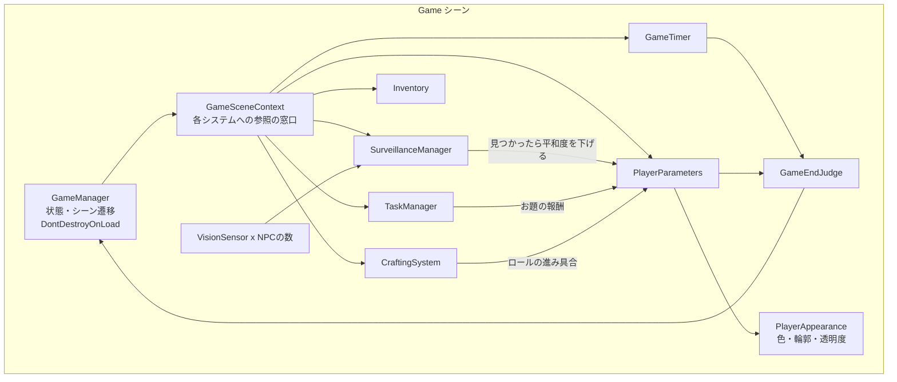

# 設計書（コードとアセットの共通ルール）

全員が同じ前提で作業するための取り決めです。**AIでコードを書くときは、このファイルとIssueの本文をセットで読ませてください。**
ここに書いてある名前（クラス名・ファイル名・フォルダ）は勝手に変えないでください。変えたいときは Issue にコメントして相談します。

---

## 1. 環境

| 項目 | 決めごと |
|---|---|
| Unity | **Unity 6 LTS（6000.0 系）**。パッチ番号は BS-01 で決めて README に書く |
| テンプレート | Universal 3D（URP） |
| 入力 | Input System パッケージ（旧 Input Manager は使わない） |
| カメラ | Cinemachine 3.x（`Unity.Cinemachine` 名前空間） |
| NPCの移動 | AI Navigation パッケージ（`NavMeshSurface` / `NavMeshAgent`） |
| UIの文字 | TextMeshPro。日本語フォントは「M PLUS Rounded 1c」または「Noto Sans JP」（どちらもOFLで無料） |
| 言語 | C#。名前空間は `Team5.〇〇` |
| 画面 | 1920×1080 を基準。Canvas Scaler は Scale With Screen Size（Match 0.5） |

---

## 2. フォルダとファイル名

```
Assets/_Project/
  Scenes/            Title.unity / Game.unity / Result.unity
    Sandbox/         個人のテストシーン（例：Sandbox_kudo.unity）
  Scripts/
    Core/            Team5.Core   … GameManager、GameSceneContext、GameTimer、PlayerParameters、GameEndJudge
    Data/            Team5.Data   … ScriptableObject の定義（RoleDefinition など）
    Player/          Team5.Player … 移動、インタラクト、見た目
    NPC/             Team5.NPC    … 巡回、視界、監視
    Tasks/           Team5.Tasks  … お題
    Items/           Team5.Items  … インベントリ、拾う、クラフト、着替え
    UI/              Team5.UI     … 画面
    Audio/           Team5.Audio  … BGM・SE
    DebugTools/      Team5.DebugTools … デバッグ用（F1 パネルなど）
  Data/              ScriptableObject のアセット本体
    Roles/  Tasks/  Items/  Recipes/  Outfits/  GameBalance.asset
  Input/             PlayerControls.inputactions
  Prefabs/           Player.prefab / NPC.prefab / Pickups/ / Stations/ / UI/
  Art/
    Characters/      CHR_〇〇.fbx
    Environment/     ENV_〇〇.fbx
    Items/           ITM_〇〇.fbx
    UI/              UI_〇〇.png
    Materials/  Shaders/  Textures/
  Animations/        ANM_〇〇.anim / 〇〇.controller
  Audio/
    BGM/             BGM_〇〇.ogg
    SE/              SE_〇〇.wav
```

- クラス名・ファイル名は英語の PascalCase（例：`PlayerMover.cs`）。1ファイル1クラス。
- アセット名の接頭辞：`CHR_` キャラ、`ENV_` 背景、`ITM_` アイテム、`UI_` UI、`ANM_` アニメ、`BGM_` `SE_` 音、`MAT_` マテリアル。
- ScriptableObject アセット名：`Role_RamenChef.asset`、`Task_Swing.asset`、`Item_ChickenBone.asset`、`Recipe_PaitanSoup.asset`、`Outfit_ChefApron.asset` のように `種類_英語名`。

### レイヤーとタグ

| 名前 | 種類 | 用途 |
|---|---|---|
| `Player` | Layer / Tag | プレイヤー |
| `NPC` | Layer / Tag | NPC・村長 |
| `Interactable` | Layer | 拾える物・お題の場所・クラフト台など |
| `Obstacle` | Layer | 視線をさえぎる壁や建物 |

### シーン

| シーン | Build番号 | 中身 |
|---|---|---|
| `Title` | 0 | タイトル画面。ここに `GameManager` を置く |
| `Game` | 1 | 本編。`GameSceneContext` とゲーム中のシステムをすべて置く |
| `Result` | 2 | 結果画面 |

---

## 3. 全体の構成



**システム同士は C# の `event` でつなぐ。** 他のシステムを探すときは `FindObjectOfType` を使わず、`GameSceneContext.Instance.〇〇` から取る。

---

## 4. 共通の型（BS-02 で雛形を作る）

以下は全員が使う型です。BS-02 で中身が空の雛形を先に作り、各Issueで中身を実装します。**シグネチャ（名前・引数・戻り値）は変えないこと。**

### 4.1 Team5.Core

```csharp
public enum GameState { Title, Playing, Paused, Result }

public enum GameResult { None, Clear, GameOverPeace, GameOverTimeUp, GameOverFaded }

public enum ParameterType { Individuality, Peace, RoleProgress }
// Individuality = 個性の濃さ / Peace = 村の平和度 / RoleProgress = なりたいロールへの進み具合

public enum Phase { Omote, Ura } // 表（見られている）/ 裏（見られていない）

public static class SceneNames
{
    public const string Title = "Title";
    public const string Game = "Game";
    public const string Result = "Result";
}

// Title シーンに置く。DontDestroyOnLoad。
public class GameManager : MonoBehaviour
{
    public static GameManager Instance { get; }
    public GameState State { get; }
    public RoleDefinition CurrentRole { get; }   // 今回のロール
    public GameResult LastResult { get; }        // 直前のゲームの結果
    public GameResultSummary LastSummary { get; } // 結果画面に出す数値
    public event Action<GameState> OnStateChanged;
    public void StartGame(RoleDefinition role);  // Game シーンを読み込み Playing にする
    public void EndGame(GameResult result, GameResultSummary summary); // Result シーンへ
    public void ReturnToTitle();
    public void SetPaused(bool paused);          // Time.timeScale を 0/1 にする
}

[Serializable]
public struct GameResultSummary
{
    public float individuality;   // 終了時の個性の濃さ（0〜100）
    public float peace;
    public float roleProgress;
    public float elapsedSeconds;
    public int tasksCompleted;
    public int timesCaught;
}

// Game シーンに1つ置く。参照の窓口。
public class GameSceneContext : MonoBehaviour
{
    public static GameSceneContext Instance { get; }
    public GameBalance Balance;            // インスペクターで設定
    public Transform Player;
    public PlayerParameters Parameters;
    public GameTimer Timer;
    public SurveillanceManager Surveillance;
    public TaskManager Tasks;
    public Inventory Inventory;
    public CraftingSystem Crafting;
}

public class GameTimer : MonoBehaviour
{
    public float Remaining { get; }
    public float Elapsed { get; }
    public bool IsRunning { get; }
    public event Action<float> OnTick;      // 毎フレーム、残り秒数
    public event Action OnTimeUp;
    public void StartTimer(float seconds);
    public void Stop();
}

public class PlayerParameters : MonoBehaviour
{
    public float Get(ParameterType type);
    public float GetNormalized(ParameterType type);         // 0〜1
    public void Add(ParameterType type, float delta, string reason); // 0〜最大値に丸める
    public event Action<ParameterType, float, float> OnChanged; // (種類, 変更前, 変更後)
}

public class GameEndJudge : MonoBehaviour { } // イベントを購読して勝敗を判定し GameManager.EndGame を呼ぶ
```

### 4.2 Team5.Data（ScriptableObject）

```csharp
[CreateAssetMenu(menuName = "Team5/GameBalance")]
public class GameBalance : ScriptableObject
{
    [Header("時間")]
    public float timeLimitSeconds = 300f;
    [Header("個性の濃さ")]
    public float individualityInitial = 50f;
    public float individualityMax = 100f;
    public float debuffThreshold = 20f;     // これ未満で移動速度が落ちる
    public float debuffSpeedMultiplier = 0.7f;
    [Header("村の平和度")]
    public float peaceInitial = 70f;
    public float peaceMax = 100f;
    public float caughtPeacePenalty = 25f;  // らしくない行動を見られたとき
    public float caughtCooldownSeconds = 3f; // 連続で減りすぎないための間隔
    [Header("ロールへの進み具合")]
    public float roleProgressMax = 100f;
    public float roleProgressToWin = 100f;
    [Header("お題")]
    public float taskIntervalSeconds = 20f; // 次のお題が出るまで
}

[CreateAssetMenu(menuName = "Team5/Role")]
public class RoleDefinition : ScriptableObject
{
    public string roleId;                  // "ramen_chef"
    public string displayName;             // "鶏白湯職人"（なりたいロール）
    public string imposedRoleName;         // "勇者"（押し付けられるらしさ）
    [TextArea] public string imposedIntro; // 冒頭で村長が言うセリフ
    public Color roleColor = Color.white;  // 個性が濃くなったときの色
    public List<TaskDefinition> imposedTasks;   // 表のお題
    public List<RecipeDefinition> recipes;      // 裏で作れるもの
    public ItemDefinition goalItem;             // 完成させるとクリアに近づく推しアイテム
    public List<OutfitDefinition> outfits;      // 段階ごとの衣装
}

public enum TaskType { ActionAtSpot, BringItem, TalkToNpc }

[CreateAssetMenu(menuName = "Team5/Task")]
public class TaskDefinition : ScriptableObject
{
    public string taskId;              // "swing"
    public string title;               // "素振りをする"
    [TextArea] public string request;  // NPCのセリフ「勇者らしく素振りをしなさい」
    public TaskType type;
    public string targetSpotId;        // ActionAtSpot / TalkToNpc の対象ID
    public ItemDefinition requiredItem; // BringItem のとき
    public int requiredCount = 1;
    public float actionSeconds = 3f;   // ActionAtSpot でかかる時間
    public float timeLimitSeconds = 30f; // この時間内にやらないと失敗（0なら無制限）
    public float peaceReward = 10f;          // 完了で平和度 +
    public float individualityCost = 10f;    // 完了で個性 -
    public float failPeacePenalty = 15f;     // 失敗で平和度 -
    public ItemDefinition rewardItem;        // こなすともらえる素材（なければ空）
    public int rewardCount = 1;
}

public enum ItemCategory { Material, Food, Outfit, Goal, Misc }

[CreateAssetMenu(menuName = "Team5/Item")]
public class ItemDefinition : ScriptableObject
{
    public string itemId;          // "chicken_bone"
    public string displayName;     // "鶏ガラ"
    [TextArea] public string description;
    public ItemCategory category;
    public Sprite icon;
    public GameObject worldPrefab; // マップに置くときの見た目
    public bool suspiciousToCarry; // true: 持っているところを見られるとまずい（今は未使用）
}

[Serializable]
public struct ItemAmount { public ItemDefinition item; public int count; }

[CreateAssetMenu(menuName = "Team5/Recipe")]
public class RecipeDefinition : ScriptableObject
{
    public string recipeId;
    public string displayName;           // "鶏白湯スープ"
    public List<ItemAmount> inputs;
    public ItemDefinition output;
    public int outputCount = 1;
    public float craftSeconds = 3f;
    public float roleProgressReward = 20f;
    public float individualityReward = 15f;
    public bool consumeOnCraft = true;   // 料理など、作ったらその場で使うものは true
}

[CreateAssetMenu(menuName = "Team5/Outfit")]
public class OutfitDefinition : ScriptableObject
{
    public string outfitId;
    public string displayName;
    public ItemDefinition item;          // 持ち物としての服
    public int stage;                    // 0:初期（制服/霧） 1:色がつく 2:ロールの衣装
    public GameObject prefab;            // プレイヤーに付けるモデル
    public string attachPoint = "Body";  // 付ける場所（Body / Head / Hand）
    public float individualityReward = 10f; // 初めて着たときの個性 +
}
```

### 4.3 インタラクト（Team5.Player）

```csharp
public interface IInteractable
{
    string Prompt { get; }                 // 画面に出す文「拾う：鶏ガラ」
    bool IsSuspicious { get; }             // 見られているときにやると「らしくない行動」になるか
    bool CanInteract(PlayerInteractor by);
    void Interact(PlayerInteractor by);
}
```

### 4.4 監視（Team5.NPC）

```csharp
public class SurveillanceManager : MonoBehaviour
{
    public bool IsPlayerWatched { get; }
    public Phase CurrentPhase { get; }               // 見られていれば Omote
    public int TimesCaught { get; }
    public event Action<Phase> OnPhaseChanged;
    public event Action<VisionSensor> OnCaught;     // らしくない行動を見られた
    public void Register(VisionSensor sensor);
    public void Unregister(VisionSensor sensor);
    public bool ReportAction(bool suspicious);       // 行動を報告。見つかったら true を返す
}
```

### 4.5 お題・アイテム（Team5.Tasks / Team5.Items）

```csharp
public enum TaskState { Active, Completed, Failed }

public class TaskInstance
{
    public TaskDefinition Definition;
    public TaskState State;
    public float Progress;       // 0〜1
    public float TimeRemaining;
}

public class TaskManager : MonoBehaviour
{
    public TaskInstance Current { get; }
    public int CompletedCount { get; }
    public event Action<TaskInstance> OnTaskAssigned;
    public event Action<TaskInstance> OnTaskCompleted;
    public event Action<TaskInstance> OnTaskFailed;
    public void Begin(RoleDefinition role);
    public void ReportSpotAction(string spotId, float seconds); // ActionAtSpot の進行
    public bool TryDeliver(ItemDefinition item);                // BringItem
    public void ReportTalk(string npcId);                       // TalkToNpc
}

public class Inventory : MonoBehaviour
{
    public int Count(ItemDefinition item);
    public bool Has(IEnumerable<ItemAmount> items);
    public void Add(ItemDefinition item, int count = 1);
    public bool Remove(ItemDefinition item, int count = 1);
    public IReadOnlyDictionary<ItemDefinition, int> All { get; }
    public event Action OnChanged;
}

public class CraftingSystem : MonoBehaviour
{
    public bool IsCrafting { get; }
    public bool CanCraft(RecipeDefinition recipe);
    public void StartCraft(RecipeDefinition recipe);  // craftSeconds かけて作る
    public void Cancel();
    public event Action<RecipeDefinition, float> OnCraftProgress; // (レシピ, 0〜1)
    public event Action<RecipeDefinition> OnCrafted;
    public event Action<RecipeDefinition> OnCraftInterrupted;     // 見つかって中断
}
```

---

## 5. 決まっていない数値の扱い

企画（PL-〇〇）で決まっていない数値は、すべて `GameBalance.asset` や各 ScriptableObject のフィールドに入れ、**コードに直接数字を書かない**。上のコードのデフォルト値は仮の値です。

企画が決まっていなくても、コード担当は仮データ（`Role_Sample.asset` など）で先に作り始めてOKです。

---

## 6. AIでコードを書くときのルール

1. AIに渡すもの：**このファイル（docs/architecture.md）＋Issueの本文**。必要なら関連する既存のスクリプトも渡す。
2. 「Issueの【作るもの】に書いたファイル以外は変更しないで」と伝える。
3. 生成されたコードは Unity で実際に再生して、Issueの【確認手順】をすべて試してからPRを出す。
4. エラーが出たら、Console のエラー全文をそのままAIに貼る。
5. 1つのIssue＝1つのPR。Issueの範囲を超えた変更は別のIssueにする。
