# UI デザイン（DS-08）

ゲーム中の表示（HUD）・タイトル・結果・持ち物・作業台の画面の見た目と、Unity で使う UI パーツ画像をまとめます。

- 色・フォント・画風は DS-01（[art-direction.md](art-direction.md)）に合わせています。**この文書で新しく足した色はありません。**
- 数値・文章は企画の文書（[parameters.md](game-design/parameters.md)・[win-lose.md](game-design/win-lose.md)・[npc.md](game-design/npc.md)・[items.md](game-design/items.md)・[outfits.md](game-design/outfits.md)・[tutorial.md](game-design/tutorial.md)）と同じです。
- 実装は CD-14（HUD）・CD-15（タイトル・結果）・CD-10 / CD-11 / CD-12（持ち物・作業台・着替え）です。

> **ステータス：案（メンバー確認待ち）**
> カンプの背景の村は DS-01 のイメージ図です。アイテムのアイコン（DS-09）、ロゴ（DS-02）、なりたい姿のシルエット（DS-06）は **仮** で描いています（最後の「まだ決まっていないこと」）。

---

## 0. 作ったもの

### デザインカンプ（`docs/game-design/images/`、すべて 1920×1080）

| ファイル | 画面 |
|---|---|
| `ui_hud.png` | HUD（見られている・見つかった直後） |
| `ui_hud_ura.png` | HUD（だれも見ていない・残り 30 秒以下・お題の時間が残りわずか） |
| `ui_hud_layout.png` | HUD の配置と大きさ（px）・アンカー |
| `ui_title.png` | タイトル |
| `ui_result.png` | 結果：クリア |
| `ui_result_peace.png` / `ui_result_faded.png` / `ui_result_timeup.png` | 結果：平和度0 / 色が消えた / 時間切れ |
| `ui_inventory.png` | 持ち物（持ち物タブ） |
| `ui_inventory_outfit.png` | 持ち物（着替えタブ） |
| `ui_craft.png` | 作業台 |
| `ui_parts.png` | UI パーツの一覧と 9 スライスの境目 |

> **11/19 更新**：`ui_title.png`・`ui_hud.png`・`ui_inventory.png`・`ui_result.png` の 4 枚を新しい見た目のカンプに差し替えました。見た目（雰囲気・色・質感）はこの 4 枚に合わせてください。下の各章の位置（px）の表は前のカンプのままなので、ずれているところがあります。
> - タイトル：ロゴとボタンが中央。「チュートリアルをもう一度見る」がチェックボックスではなくボタン
> - 持ち物：持ち物と作業台が 1 つの窓（左右）に並んでいる（`ui_craft.png` は前のまま）
> - 結果：見出しが上の帯、数値が縦 4 行、ボタンは「タイトルへ」だけ

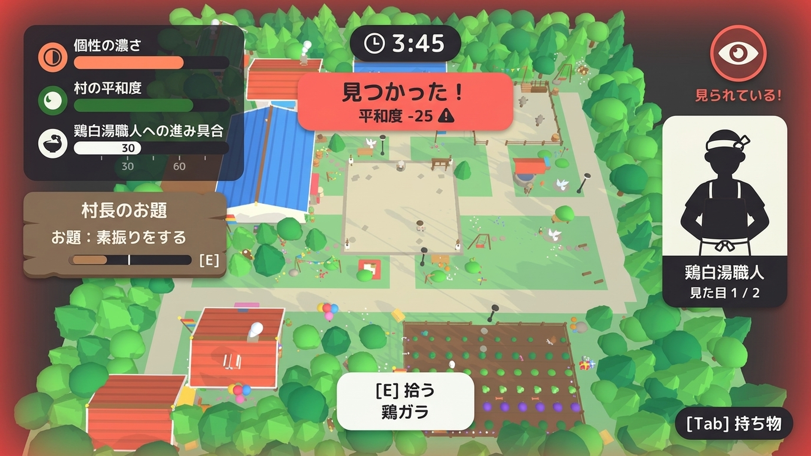

### UI パーツ（`Assets/_Project/Art/UI/UI_〇〇.png`）

41 枚。9 スライスの余白は 8 章の表にあります。

---

## 1. 共通のルール

### 画面

- 基準解像度 **1920×1080**。Canvas Scaler は `Scale With Screen Size`・Reference Resolution 1920×1080・Match **0.5**。
- 画面の端からの余白は **40px**（上だけ 32px）。要素どうしのすき間は 20px 以上。
- パーツ画像は 1920×1080 で等倍（Pixels Per Unit 100）になる大きさで作っています。

### 下敷きの使い分け

| 下敷き | パーツ | 使う場所 | 理由 |
|---|---|---|---|
| 暗い（`#2E2B33` 85%） | `UI_Panel_Dark` | HUD の数値・時間・目・なりたい姿 | 明るい村の上でも白い文字が読める（13.0 : 1） |
| 明るい（`#FBF7EF`） | `UI_Panel_Light` | お題カード・操作のヒント・持ち物と作業台の窓・ボタン | 「読むもの・押すもの」は明るく。村の色とも近い |

### 色の役割

DS-01 の「押し付けられた『らしさ』＝くすんだ色、自分の『らしさ』＝あざやかな色」を UI でも守ります。

| 色 | 使う場所 |
|---|---|
| ロールの色（ramen_chef は `#F2A33A`） | 個性のゲージ、なりたい姿、クリアの画面、裏の行動で手に入る物の数値（+30 など） |
| 古い木 `#8A7563` | **村長のお題**（押し付けられる側）の札・お題の残り時間のバー |
| 強調 `#FFC83D` | 平和度のゲージ、選んでいるもの（ボタン・マス）、メインのボタン |
| 警告 `#D63C42` | 見られている、見つかった、下がった分、残り時間が少ない |
| くすみ石 `#9A968F` | 持っていない・足りない・押せない（灰色） |

### フォント

| 用途 | フォント | 太さ | 大きさ（px） |
|---|---|---|---|
| 残り時間・大きな見出し | M PLUS Rounded 1c | ExtraBold | 64〜100 |
| ボタン・お題・通知 | M PLUS Rounded 1c | ExtraBold | 30〜52 |
| ゲージ名・小見出し・札 | M PLUS Rounded 1c | Bold | 18〜22 |
| 説明・アイテム名・数字の補足 | Noto Sans JP | Medium / Bold | 17〜24 |

- いちばん小さい文字は **17px**（1920×1080 のとき）。これより小さくしないでください。
- キーの表示（`E`・`Tab`・`Esc`）は `UI_KeyCap` の上に M PLUS Rounded 1c ExtraBold を乗せます。

---

## 2. HUD（ゲーム中の表示）

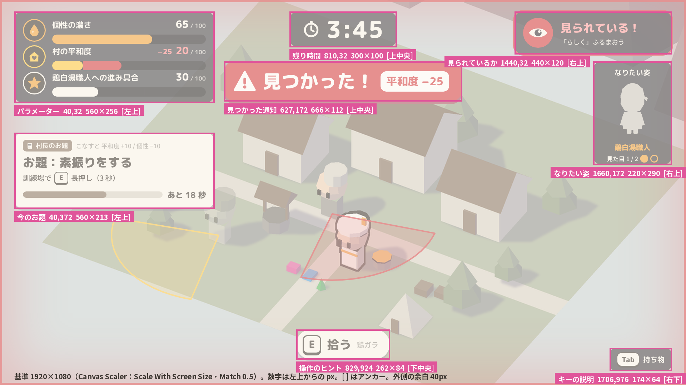

### 配置

| 要素 | 位置・大きさ（px） | アンカー | 中身 | データ（CD-14） |
|---|---|---|---|---|
| パラメーター 3 つ | 40, 32 / 560×256 | 左上 | 個性の濃さ・村の平和度・{なりたいロール}への進み具合。アイコン・名前・数値・ゲージ | `PlayerParameters.OnChanged` / `GetNormalized` |
| 今のお題 | 40, 372 / 560×213 | 左上 | 「村長のお題」の札、「お題：素振りをする」、場所と操作、残り時間のバーと秒 | `TaskManager.OnTaskAssigned` / `Completed` / `Failed`、`Current.TimeRemaining` |
| 残り時間 | 810, 32 / 300×100 | 上中央 | 時計のアイコン＋「3:45」 | `GameTimer.OnTick` |
| 見られているか | 1440, 32 / 440×120 | 右上 | 目のアイコン＋「見られている！」/「だれも見ていない」 | `SurveillanceManager.OnPhaseChanged` |
| なりたい姿 | 1660, 172 / 220×290 | 右上 | 段階 2 のシルエット、ロール名、「見た目 1 / 2」 | 着替え（CD-12）の `CurrentStage` |
| 見つかった通知 | 中央, 172 / 幅は文字に合わせる×112 | 上中央 | 「見つかった！」＋「平和度 −25」 | `SurveillanceManager.OnCaught` |
| 操作のヒント | 中央, 下から 72 / 幅は文字に合わせる×84 | 下中央 | `[E]` ＋「拾う」＋対象の名前（小さく） | `PlayerInteractor.OnFocusChanged`（`IInteractable.Prompt`） |
| キーの説明 | 右下 40, 40 | 右下 | `[Tab] 持ち物` | 固定 |
| 画面の縁 | 全面 | 全面ストレッチ | 見られているときだけ赤くする | `OnPhaseChanged` |

- 視界の扇形（黄色／赤）は 3D 側（CD-08b）で描きます。HUD では描きません。
- 見つかった通知は、ほかの要素と重なってもよい（いちばん上に出す）位置にしています。

### 動き

| 要素 | いつ | どう見せるか |
|---|---|---|
| ゲージ | 値が変わったとき | 0.3 秒かけて動く（CD-14） |
| ゲージ | **下がったとき** | 下がった分を警告色 `#D63C42` で残し、0.3 秒後に縮める。数値の横に「−25」を 1.5 秒出す（`ui_hud.png` の平和度） |
| 個性のゲージ | 20 未満（足が遅い） | ゲージとアイコンを 0.5 秒ごとに点滅（parameters.md・win-lose.md） |
| 平和度・個性の数値 | 25 以下（あと 1 回で負けに近い） | 数値の文字を警告色にする |
| 進み具合のゲージ | 常に | 30・60 の位置に目盛り（レシピ 1 つ分）。ゲージの中身は白、アイコンの星はロールの色 |
| 残り時間 | 残り **30 秒以下** | 文字とアイコンを `#FF8A8E`（暗い下敷きの上の警告色）にする（CD-14） |
| お題の残り時間 | 残りが制限時間の 1/3 以下 | バーと秒を警告色にする |
| 見られているか | 見られた瞬間 | 丸を赤にし、目を開く。パネルのふちに赤い線。画面の縁（`UI_Vignette_Watched`）を 0.2 秒でフェードイン |
| 見られているか | 見られなくなった瞬間 | 目を閉じ、縁を 0.3 秒でフェードアウト |
| 見つかった通知 | `OnCaught` | 上から 0.15 秒でおりてきて **2 秒** 出し、0.3 秒で消える。罰の間隔（3 秒）中は出し直さない（npc.md の「罰の間隔中のルール」） |
| 操作のヒント | 調べられる物に近づいたとき | 0.1 秒でフェードイン。遠ざかったら消す |

- **毎フレーム文字列を作らない**（CD-14）。時間は秒が変わったときだけ、ゲージの数値は `OnChanged` のときだけ更新します。

### 中の文字

| 要素 | 文字 | 元 |
|---|---|---|
| ゲージ名 | 「個性の濃さ」「村の平和度」「{displayName}への進み具合」 | parameters.md |
| お題 | 「お題：{TaskDefinition.title}」 | tasks.md |
| お題の操作 | ActionAtSpot：「{場所}で [E] 長押し（{秒} 秒）」／ BringItem：「村長の家へ [E] 渡す（薪 {持っている数}/{必要数}）」／ TalkToNpc：「見張りに [E] 話しかける」 | tasks.md の type |
| お題の補足 | 「こなすと 平和度 +10 / 個性 −10」 | parameters.md |
| 見られているか | 「見られている！」「らしく ふるまおう」／「だれも見ていない」「今なら こっそり動ける」 | |
| 見つかった通知 | 「見つかった！」「平和度 −25」（数字は `caughtPeacePenalty`） | npc.md |
| 操作のヒント | 「拾う」「作る」「着替える」「渡す」「話す」などは `IInteractable.Prompt` をそのまま | |

---

## 3. タイトル

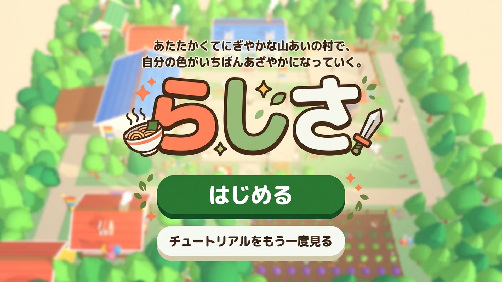

| 要素 | 位置（px） | 中身 |
|---|---|---|
| ロゴ | 150, 150 | 仮ロゴ `UI_Logo_Temp`（DS-02 のロゴができたら差し替え）。「さ」だけロールの色＝くすんだ村で 1 つだけあざやか |
| はじめる | 150, 560 / 560×110 | `UI_Button_Primary_Selected`（最初から選択）。左に「▶」 |
| チュートリアルをもう一度見る | 150, 712 / 560×84 | **チェックボックス**（CD-15 の仕様）。`UI_Checkbox_On/Off` |
| 補足 | 150, 812 | 「初めて遊ぶときは、チェックがなくてもチュートリアルから始まります」 |
| キーの説明 | 左下 | `[↑↓] 選ぶ` `[Enter] 決める` |
| チーム名 | 右下 | 「メンターハッカソン チーム5」 |
| 背景 | 全面 | 村の 3D（ゆっくりカメラが回る or 静止画）の上に、左から `#FBF7EF` のグラデーション（0〜34% 不透明、70% で透明） |

- 「はじめる」→ チュートリアル（初回、またはチェックあり）→ 本編。2 回目からはチェックがなければ本編へ直接（tutorial.md 2 章「2 回目からはスキップできる」）。
- CD-20（ロール選択）ができたら「はじめる」の次にロール選択をはさみます。ロール選択のカードは `UI_Panel_Light` と `UI_Slot_Selected` で作れます。
- ゲームパッド：EventSystem の First Selected は「はじめる」。

---

## 4. 結果

| クリア | 平和度0 |
|---|---|
| 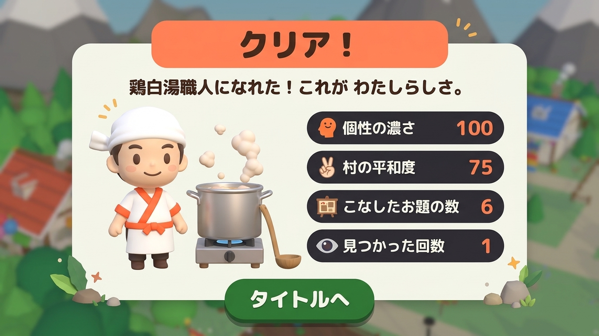 | 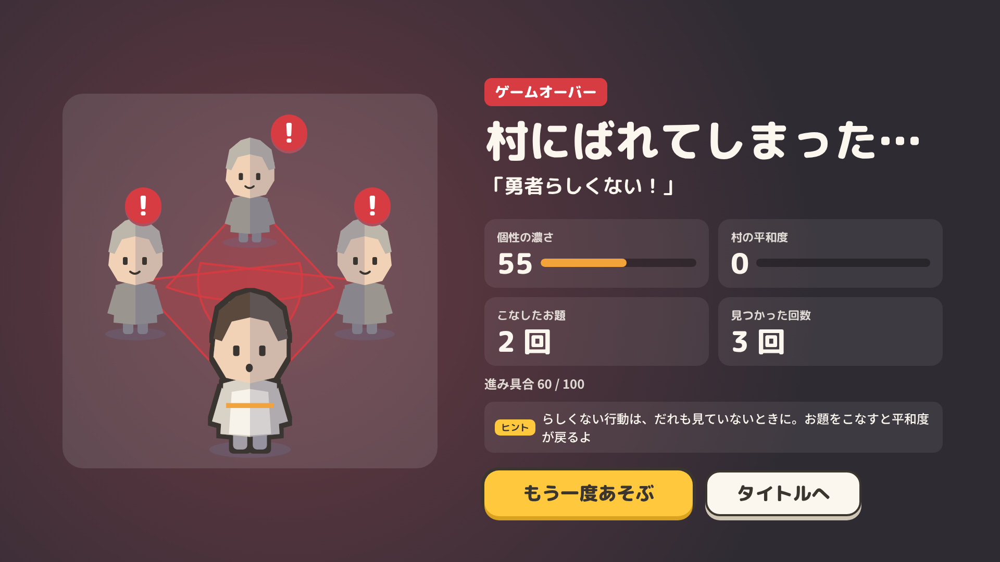 |
| **色が消えた** | **時間切れ** |
| 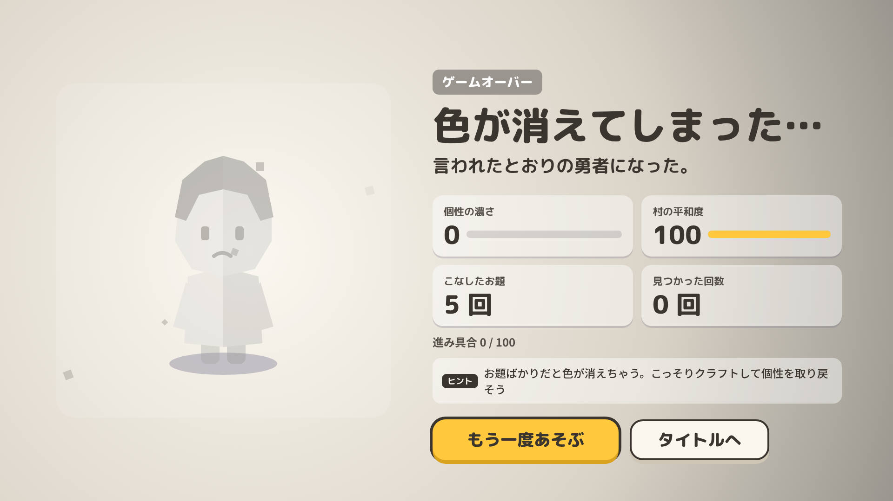 | 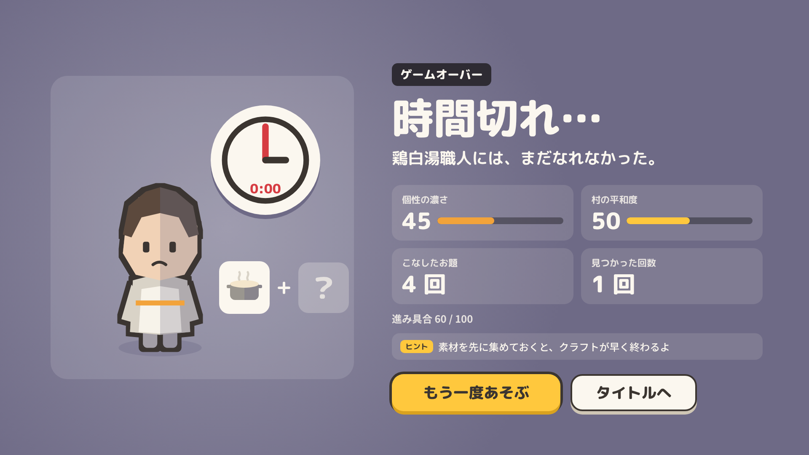 |

### 配置（4 つとも同じ）

| 要素 | 位置・大きさ（px） | 中身 |
|---|---|---|
| 結果の絵 | 120, 180 / 720×720 | `UI_Result_〇〇.png`（下の表） |
| 結果のラベル | 930, 150 | 「クリア」/「ゲームオーバー」 |
| 見出し | 930, 222 | 下の表（M PLUS Rounded 1c ExtraBold 84〜100px） |
| 一言 | 930, 329 | win-lose.md 1 章の一言（2 行目） |
| 終了時の数値 | 930, 421 / 880×283 | 2×2 のカード：**個性の濃さ・村の平和度・こなしたお題の数・見つかった回数**（`GameResultSummary`）。個性と平和度は小さいゲージ付き |
| 追加の数値 | 数値の下 1 行 | クリア：かかった時間（`elapsedSeconds`）／ゲームオーバー：進み具合 |
| ヒント | 930, 772 / 880×63 | win-lose.md 4 章のヒント 1 行 |
| ボタン | 930, 869 | 「もう一度あそぶ」（選択中）・「タイトルへ」 |

### 結果ごとに変えるもの

| `GameResult` | 背景 | ラベル | 見出し | 一言 | 絵 |
|---|---|---|---|---|---|
| `Clear` | ロールの色 `roleColor` の放射グラデーション | 「クリア」（`#3B3530` に `#FFC83D` の文字） | 「{displayName}になれた！」 | 「これが わたしらしさ。」 | `UI_Result_Clear`：ロールの色の服・エプロン・頭タオルで鶏白湯を持つ。太い輪郭線、光の線とキラキラ |
| `GameOverPeace` | `#2E2B33` に赤みのグラデーション | 「ゲームオーバー」（警告色） | 「村にばれてしまった…」 | 「『{imposedRoleName}らしくない！』」 | `UI_Result_Peace`：村人 3 人に囲まれ、赤い視界と「！」 |
| `GameOverFaded` | `#FBF7EF` → `#D9D3C7` → `#9A968F`（色がない） | 「ゲームオーバー」（くすみ石） | 「色が消えてしまった…」 | 「言われたとおりの{imposedRoleName}になった。」 | `UI_Result_Faded`：灰色で透けたプレイヤー、輪郭線なし、体が四角いかけらになって散る |
| `GameOverTimeUp` | 影の色 `#6E6A86` のグラデーション（夕暮れ） | 「ゲームオーバー」（暗） | 「時間切れ…」 | 「{displayName}には、まだなれなかった。」 | `UI_Result_TimeUp`：0:00 の時計、作りかけ（スープ＋？） |

- 文章は win-lose.md の「結果画面の一言」を、見出し（1 行目）と一言（2 行目）に分けただけです。言い回しを直すときは win-lose.md と一緒に。
- 結果の絵は ramen_chef 用です。ロールを増やすとき（M2）はクリアの絵だけロールごとに作り、ゲームオーバーの 3 枚は服の色以外そのまま使えます。
- CD-15 の「クリア時は衣装のスクリーンショット（あれば）」を使う場合は、クリアの絵の場所（720×720）に入れてください。

---

## 5. 持ち物（Tab）

| 持ち物タブ | 着替えタブ |
|---|---|
| 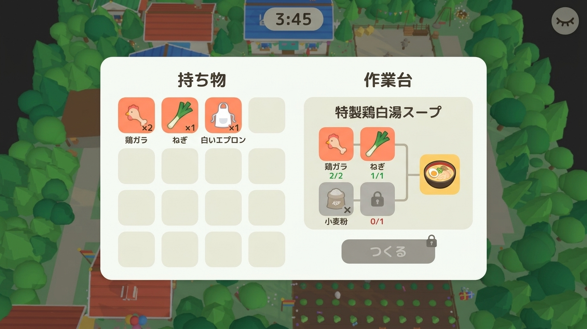 | 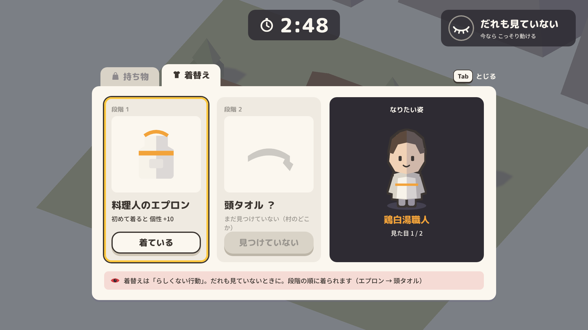 |

- **開いていてもゲームは止まらない**（CD-10）。なので、残り時間と「見られているか」は窓の上に出したままにします。パラメーターとお題は窓に隠れるので消します。
- 村は `#2E2B33` 50% で暗くします。
- 窓：1320 幅、中央。上にタブ（`UI_Tab_On` / `UI_Tab_Off`）と `[Tab] とじる`。

### 持ち物タブ

| 要素 | 中身 |
|---|---|
| 一覧 | 4 列 × 3 行のマス（`UI_Slot`、160×160）。アイコン（DS-09 の `ICON_<itemId>`、104px）と右下に個数「×2」（`UI_Badge`）。空きマスは何も出さない |
| 選んでいるマス | `UI_Slot_Selected` |
| 選んだアイテム（右） | 大きいアイコン、名前、種類の札（`UI_Chip`：素材・食べ物・服・目標）、個数、説明（items.md の 30 字以内）、「使うレシピ」 |
| 注意 | 「持ち物を開いていても、時間は進みます」 |
| 左下 | `[WASD] 選ぶ`、「持ち物 5 / 12」 |

- アイコンがまだないとき（DS-09 の前）は、マスに `displayName` の文字を出します（CD-10 の仕様）。

### 着替えタブ（outfits.md 3 章・6 章）

| 要素 | 中身 |
|---|---|
| 服のカード | 段階の順に左から。持っている服：アイコン・名前・「初めて着ると 個性 +10」・「着る」ボタン。着ている服：`UI_Slot_Selected` の枠と「着ている」 |
| まだ持っていない服 | 黒いシルエット＋「頭タオル ？」「まだ見つけていない（村のどこか）」、ボタンは `UI_Button_Disabled` |
| 段階が飛んでいる服 | 持っていても押せない。ボタンは `UI_Button_Disabled` で「先にエプロンを着よう」 |
| なりたい姿（右） | 今の見た目のキャラと「見た目 1 / 2」 |
| 注意 | 「着替えは『らしくない行動』。だれも見ていないときに。」 |

---

## 6. 作業台（台所）

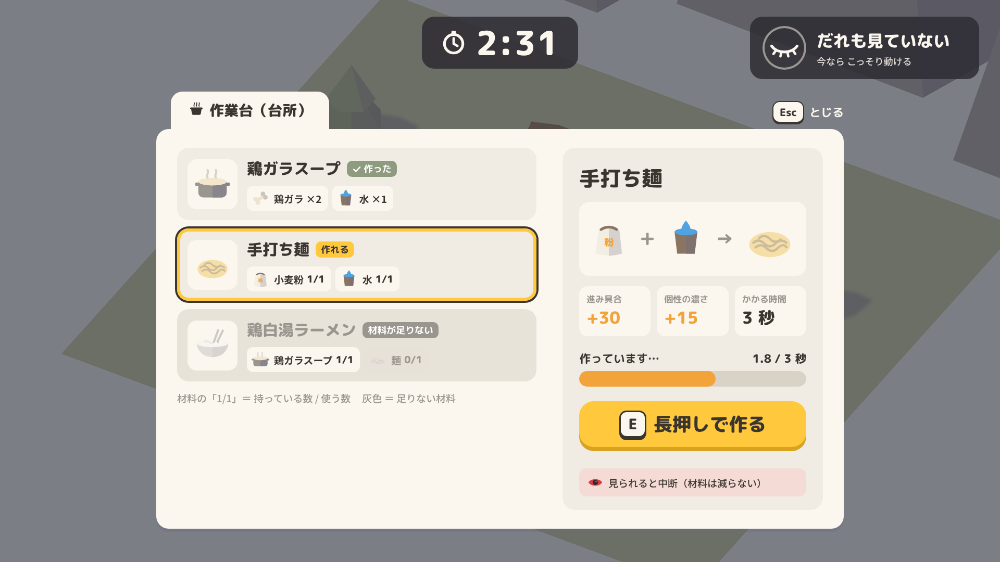

- 作業台で `[E] 作る` → この窓が開きます。作っている間は動けない（CD-11）ので、時間と「見られているか」は出したままにします。閉じるのは `[Esc]`。

| 要素 | 中身 |
|---|---|
| レシピの一覧（左） | 今のロールの `recipes` を上から。1 行に できる物のアイコン・名前・状態の札・材料 |
| 状態の札 | 「作れる」（強調色）／「材料が足りない」（灰色）／「作った」（苔のみどり＋チェック） |
| 材料 | アイコン＋名前＋「持っている数 / 使う数」。**足りない材料はアイコンも文字も灰色**（アイコンは白黒・35%） |
| 足りないレシピ | 行ごと灰色。選べるが「長押しで作る」は押せない |
| 作ったレシピ | 材料を「鶏ガラ ×2」の形で（数は使った数）。もう作れない（items.md：素材はちょうど足りる数） |
| 選んだレシピ（右） | 材料 ＋ 材料 → できる物の絵、進み具合 +30・個性 +15・かかる時間 3 秒、作っている進みのバー（ロールの色）、`[E] 長押しで作る` |
| 注意 | 「見られると中断（材料は減らない）」 |

- 作っている間に見つかったら、HUD の「見つかった通知」を窓の上に出し、進みのバーを 0 に戻します。

---

## 7. 色・数値のまとめ（実装用）

```
UI 背景        #FBF7EF   UI 背景（暗）  #2E2B33（不透明度 85%）
文字           #3B3530   強調           #FFC83D（ボタンの下の段 #D9A21F）
警告           #D63C42   暗い下敷きの上の警告文字 #FF8A8E
くすみ石       #9A968F   霧の生成り     #D9D3C7   古い木 #8A7563
ロールの色     RoleDefinition.roleColor（ramen_chef = #F2A33A）
```

| 項目 | 値 |
|---|---|
| 画面の端の余白 | 40px（上 32px） |
| 角の丸み | 窓・パネル 24px、ボタン 28px、マス 22px、ゲージ 13px（高さの半分） |
| ボタンの高さ | 88px（タイトルの「はじめる」だけ 110px） |
| ボタンの下の段（押せる感じ） | 8px |
| ゲージの高さ | HUD 26px、お題 18px、作業台 30px |

---

## 8. UI パーツ（9 スライスの余白）

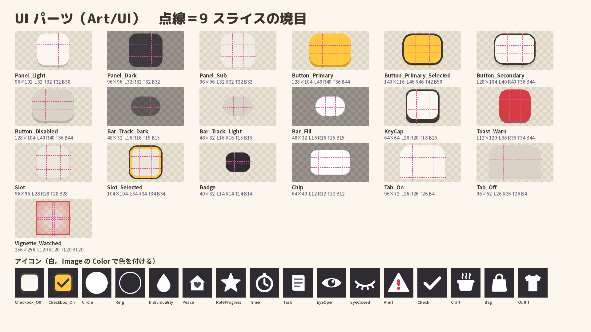

### Unity での読み込み設定（全部共通）

| 項目 | 値 |
|---|---|
| Texture Type | Sprite (2D and UI) |
| Sprite Mode | Single |
| Pixels Per Unit | 100 |
| Mesh Type | Full Rect（9 スライスするもの） |
| Filter Mode | Bilinear |
| Compression | None（UI がにじまないように。サイズは小さいので問題なし） |
| Generate Mip Maps | オフ |

- 9 スライスするものは Sprite Editor の **Border** に下の表の L / R / T / B を入れ、Image の **Image Type = Sliced** にします。
- 白いパーツ（`UI_Bar_Fill`・`UI_Chip`・`UI_Circle`・`UI_Ring`・アイコン）は Image の **Color** で色を付けます。
- ゲージの中身は **Sliced のまま幅を変えて** 伸ばします（Filled にすると 9 スライスが効かない）。`RectTransform.anchorMax.x = 値` にするのが簡単です。
- 高さが余白の合計より小さいとき（お題のバー 18px など）は、Unity が自動で角を縮めます。角の丸みを変えたいときは Image の **Pixels Per Unit Multiplier** を変えてください（大きくすると角が小さくなる）。
- `UI_Vignette_Watched` は Image の **Fill Center をオフ**、全画面にストレッチ。
- 下の段（影）付きのパーツ（`UI_Panel_Light`・ボタン・`UI_KeyCap`・`UI_Toast_Warn`）は、画像の下の数 px が影です。文字は影を除いた部分の中央に置いてください（下の B が大きいのはそのため）。

| ファイル | 大きさ（px） | 9 スライスの余白 | 使う場所 |
|---|---|---|---|
| `UI_Panel_Light.png` | 96×102 | L 32 / R 32 / T 32 / B 38 | お題カード・持ち物/作業台の窓・結果の数値カード（明るい下敷き） |
| `UI_Panel_Dark.png` | 96×96 | L 32 / R 32 / T 32 / B 32 | HUD のパラメーター・残り時間・目のアイコン・なりたい姿（暗い下敷き 85%） |
| `UI_Panel_Sub.png` | 96×96 | L 32 / R 32 / T 32 / B 32 | 窓の中の小さい区画（選んだアイテム・レシピの詳細） |
| `UI_Button_Primary.png` | 128×104 | L 40 / R 40 / T 36 / B 44 | メインのボタン（はじめる・もう一度あそぶ・長押しで作る・着る） |
| `UI_Button_Primary_Selected.png` | 140×116 | L 46 / R 46 / T 42 / B 50 | 選んでいるメインのボタン（ゲームパッド/キーボードで選択中） |
| `UI_Button_Secondary.png` | 128×104 | L 40 / R 40 / T 36 / B 44 | サブのボタン（タイトルへ・着ている） |
| `UI_Button_Disabled.png` | 128×104 | L 40 / R 40 / T 36 / B 44 | 押せないボタン（見つけていない・材料が足りない） |
| `UI_Bar_Track_Dark.png` | 48×32 | L 16 / R 16 / T 15 / B 15 | 暗い下敷きの上のゲージの溝（パラメーター 3 本） |
| `UI_Bar_Track_Light.png` | 48×32 | L 16 / R 16 / T 15 / B 15 | 明るい下敷きの上のゲージの溝（お題の残り時間・作っている進み） |
| `UI_Bar_Fill.png` | 48×32 | L 16 / R 16 / T 15 / B 15 | ゲージの中身（白。Image の Color で色を付ける） |
| `UI_KeyCap.png` | 64×64 | L 20 / R 20 / T 18 / B 26 | キーの表示（E・Tab・Esc・Enter。文字は TextMeshPro で上に乗せる） |
| `UI_Toast_Warn.png` | 112×120 | L 36 / R 36 / T 34 / B 44 | 「見つかった！ 平和度 −25」の通知 |
| `UI_Slot.png` | 96×96 | L 28 / R 28 / T 28 / B 28 | 持ち物のマス・レシピの行 |
| `UI_Slot_Selected.png` | 104×104 | L 34 / R 34 / T 34 / B 34 | 選んでいるマス・行・着ている服 |
| `UI_Badge.png` | 40×32 | L 14 / R 14 / T 14 / B 14 | 個数「×2」の札 |
| `UI_Chip.png` | 64×40 | L 12 / R 12 / T 12 / B 12 | 小さい札（村長のお題・素材・作れる・作った・ヒント）。白なので Color で色を付ける |
| `UI_Tab_On.png` | 96×72 | L 26 / R 26 / T 26 / B 4 | 開いているタブ（持ち物 / 着替え） |
| `UI_Tab_Off.png` | 96×62 | L 26 / R 26 / T 26 / B 4 | 開いていないタブ |
| `UI_Vignette_Watched.png` | 256×256 | L 120 / R 120 / T 120 / B 120 | 見られているときの画面の縁（Fill Center をオフ） |
| `UI_Checkbox_Off.png` | 64×64 | －（伸ばさない） | チェックボックス（オフ） |
| `UI_Checkbox_On.png` | 64×64 | －（伸ばさない） | チェックボックス（オン） |
| `UI_Circle.png` | 128×128 | －（伸ばさない） | 丸（白。目のアイコンの赤い丸・ゲージのアイコンの下敷き） |
| `UI_Ring.png` | 128×128 | －（伸ばさない） | 輪（白。ゲージのアイコンのふち・見られていないときの目の丸） |
| `UI_Icon_Individuality.png` | 128×128 | －（伸ばさない） | 個性の濃さ（しずく） |
| `UI_Icon_Peace.png` | 128×128 | －（伸ばさない） | 村の平和度（家とハート） |
| `UI_Icon_RoleProgress.png` | 128×128 | －（伸ばさない） | ロールへの進み具合（星） |
| `UI_Icon_Timer.png` | 128×128 | －（伸ばさない） | 残り時間 |
| `UI_Icon_Task.png` | 128×128 | －（伸ばさない） | 村長のお題 |
| `UI_Icon_EyeOpen.png` | 128×128 | －（伸ばさない） | 見られている（開いた目） |
| `UI_Icon_EyeClosed.png` | 128×128 | －（伸ばさない） | だれも見ていない（閉じた目） |
| `UI_Icon_Alert.png` | 128×128 | －（伸ばさない） | 見つかった！（三角に！。中の！は警告色） |
| `UI_Icon_Check.png` | 128×128 | －（伸ばさない） | 作った・チェック |
| `UI_Icon_Craft.png` | 128×128 | －（伸ばさない） | 作業台のタブ |
| `UI_Icon_Bag.png` | 128×128 | －（伸ばさない） | 持ち物のタブ |
| `UI_Icon_Outfit.png` | 128×128 | －（伸ばさない） | 着替えのタブ |
| `UI_Silhouette_RamenChef.png` | 200×280 | －（伸ばさない） | なりたい姿のシルエット（仮。DS-06 の衣装ができたら差し替え） |
| `UI_Logo_Temp.png` | 800×250 | －（伸ばさない） | 仮ロゴ（DS-02 のロゴができたら差し替え） |
| `UI_Result_Clear.png` | 720×720 | －（伸ばさない） | 結果の絵：クリア（背景はロールの色） |
| `UI_Result_Peace.png` | 720×720 | －（伸ばさない） | 結果の絵：平和度0（村人に囲まれる） |
| `UI_Result_Faded.png` | 720×720 | －（伸ばさない） | 結果の絵：色が消えた（灰色で透ける） |
| `UI_Result_TimeUp.png` | 720×720 | －（伸ばさない） | 結果の絵：時間切れ（時計と作りかけ） |

---

## まだ決まっていないこと

| # | 内容 | だれが | 状態 |
|---|---|---|---|
| 1 | ロゴ。今は仮ロゴ `UI_Logo_Temp` | DS-02 | 差し替え待ち |
| 2 | アイテムのアイコン。カンプのアイコンは仮で、パーツとしては出していません | DS-09（`Art/UI/Icons/ICON_<itemId>.png`） | 差し替え待ち |
| 3 | なりたい姿のシルエット `UI_Silhouette_RamenChef` と結果の絵のキャラは仮 | DS-06 の衣装ができたら合わせる | 仮 |
| 4 | ロール選択の画面（CD-20） | この文書のパーツで作れる想定。必要ならカンプを追加 | 未作成（P1） |
| 5 | メンバーに見てもらい、CD-14・CD-15 の担当に共有する | DS-08 担当 | **未確認** |

## 関係する文書

- [art-direction.md](art-direction.md)：色・フォント・画風（DS-01）
- [game-design/parameters.md](game-design/parameters.md)：パラメーターの数値・20 未満で点滅
- [game-design/win-lose.md](game-design/win-lose.md)：4 つの結果と、結果画面の一言・ヒント
- [game-design/npc.md](game-design/npc.md)：見つかったときの罰（−25）と罰の間隔
- [game-design/items.md](game-design/items.md)：アイテム・レシピ
- [game-design/outfits.md](game-design/outfits.md)：着替えタブ・なりたい姿
- [game-design/tutorial.md](game-design/tutorial.md)：チュートリアルのスキップ
