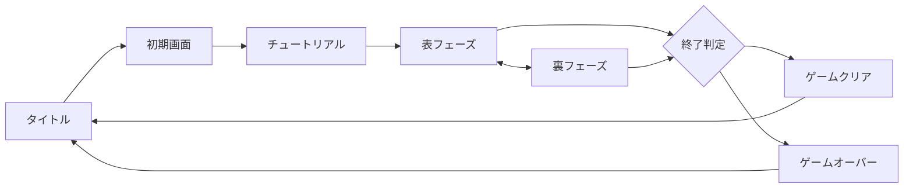

# 要件定義

チーム5 / メンターハッカソン
最終更新：2026-11-14

> この文書は「何を作るか」を決めるためのものです。決まっていない項目には **【未定 → タスクID】** と書いています。決まったらこの文書も更新してください。

---

## 1. コンセプト

### 伝えたいメッセージ
人に押し付けられた「らしさ」ではなく、自分が思う「らしさ」を追い求めよう。

### ひとことで言うと
「〇〇らしく」を求められる村で、言われたとおりに振る舞いながら、見られていない隙に「本当になりたい自分」へ少しずつ変わっていくゲーム。

### 世界観
- チームメンバーそれぞれの好きなものを混ぜた村。
- 参考：村づくり・スローライフ系の3Dゲーム、牧場系のドット絵ゲーム、俯瞰で見る小さな村。
- 画風・色・フォントは **【未定 → DS-01】**

---

## 2. 基本情報

| 項目 | 内容 |
|---|---|
| プレイ人数 | 1人 |
| 表現 | 3D |
| ゲームエンジン | Unity（バージョンは **【未定 → BS-01】**） |
| 対象プラットフォーム | PC（発表用PCで動くこと） |
| 操作 | キーボード＋マウス |
| 1プレイの長さ | 数分程度を想定。**【未定 → PL-11】** |
| コードフリーズ | 2026-11-20（金）23:59（orgのリポジトリ＋提出フォーム） |
| スライド提出 | 2026-11-21（土）23:59 |
| 発表 | 2026-11-22（日）5分＋質疑3分。挑戦した技術の詳細は必須 |
| 評価軸 | UI/UX・新規性・技術・らしさ |

---

## 3. ゲームの流れ

### 3.1 ストーリー
「らしく」生きる村に生まれたプレイヤーは、NPCから「勇者らしく」「長男らしく」などの役割を期待される。期待どおりに動けば村は平和だが、プレイヤーの色はどんどん薄くなっていく。

### 3.2 プレイの流れ

1. **最初の状態**
   - プレイヤーは霧のようにぼやけた姿（または全員同じ村人の制服）で始まる。
   - 最初に、押し付けられる「らしさ」がはっきり示される。
2. **表フェーズ（NPCに見られている間）**
   - 村長やNPCが期待する「〇〇らしい行動」をこなす（例：勇者らしく素振りをする）。
   - こなすと村の平和度は保たれるが、プレイヤーの色が薄くなり、透明（無個性なモブ）に近づく。
3. **裏フェーズ（見られていない間）**
   - 監視の目を盗んで、マップから「自分の好きなもの」の材料を集める。
   - こっそりクラフト・料理・着替えをする（例：鶏白湯スープを作る）。
4. **変化**
   - 同じ傾向の行動を繰り返すと、輪郭が濃くなり、色がつき、能力や見た目（服装・装備）が「自分らしい姿」に固まっていく。
   - 服装はタスクを進める中で選べる。
5. **終了判定** → クリア / ゲームオーバー

### 3.3 画面の流れ

表と裏の切り替え方（見られているかで自動か、プレイヤーが操作するか）は **【未定 → PL-08】**

---

## 4. ルール

### 4.1 ロール（らしさ）
- 押し付けられる「らしさ」と、本当になりたいロールの2種類がある。
- ロールは**複数**用意する。MVPではまず1組で最後まで遊べるようにする。
- 種類と組み合わせ **【未定 → PL-01】**

| 押し付けられる「らしさ」（例） | なりたいロール（例） |
|---|---|
| 勇者らしく | 鶏白湯職人 |
| 長男らしく | ダンサー |

### 4.2 タスク
- 表のお題（NPCに求められる行動）と、裏の行動（なりたいロールに近づく行動）がある。
- ロールごとの内容 **【未定 → PL-02】**
- お題をどれだけ「らしく」こなせたかの判定方法 **【要審議 → PL-05】**（タスクとアイテムの内容によって変わる）

### 4.3 アイテム
- 素材を集め、レシピに沿ってクラフト・料理・着替えをする。
- 種類とレシピ **【未定 → PL-03】**
- 目的以外のアイテム（寄り道要素）を入れるか **【未定 → PL-09】**

### 4.4 パラメーター
案として、次の3つを考えている。最終的な種類と数値は **【未定 → PL-04】**

| パラメーター | 意味 | 上がる | 下がる |
|---|---|---|---|
| 個性の濃さ | プレイヤーの色・輪郭の濃さ | 裏の行動 | 表のお題をこなす |
| 村の平和度 | 村がプレイヤーを受け入れているか | 表のお題をこなす | らしくない行動を見られる |
| ロールへの進み具合 | なりたいロールにどれだけ近づいたか | クラフト・着替えなど | － |

### 4.5 勝利条件
制限時間内に、透明（無個性）にならず、気づかれずに、なりたいロールへの変化条件（例：ゲージMAX、衣装の変化、推しアイテムの完成）を満たす。

### 4.6 敗北条件
- 見られている間に「らしくない行動」をして、平和度が0になる。
- 制限時間が切れる。
- 言われたことばかりこなして、色が完全に消えてしまう。

個性を失いすぎた場合は、状況によってゲームオーバーにつながる。デバフを挟むかどうか、具体的な数値は **【未定 → PL-06】**

### 4.7 難易度・制限時間
一度ゲームシステムを作って遊んでから決める **【未定 → PL-11】**

---

## 5. MVP（最低限ここまで作る）

M1（11/17）までに、見た目は仮でよいので次ができる状態を目指す。

- [ ] タイトル → 本編 → 結果 → タイトル の一周
- [ ] プレイヤーが村を歩ける
- [ ] NPCに見られている/いないがわかる
- [ ] 1ロール分の表のお題をこなせる
- [ ] 1ロール分の素材を集めて、最終アイテムを作れる
- [ ] パラメーターに合わせてプレイヤーの色が変わる
- [ ] 制限時間・勝利・敗北の判定ができる

M2以降で追加するもの：複数ロール、衣装の着替え、本番モデル・アニメーション、サウンド、チュートリアル、演出。

---

## 6. スケジュール

| マイルストーン | 期限 | ゴール |
|---|---|---|
| M0 企画・基盤 | 11/16（月） | MVPのロール・タスク・パラメーターが決まり、Unityプロジェクトを全員が開ける |
| M1 プロトタイプ | 11/17（火）21:30 会議 | 1ロールで最後まで通しで遊べる |
| M2 コンテンツ拡充 | 11/19（木）21:30 会議 | 複数ロール・見た目の変化・本番アセット・サウンド |
| M3 コードフリーズ・提出 | 11/20（金）23:59 | ビルド、README、提出フォーム |
| M4 発表準備 | 11/21（土）23:59 | スライド提出、デモ動画、挑戦した技術のまとめ |
| 発表 | 11/22（日） | 5分＋質疑3分 |

### 会議

| 日時 | 内容 |
|---|---|
| 11/17（火）21:30〜 | プロトタイプを全員で遊ぶ。難易度・制限時間の方向性、M2で追加するロールを決める |
| 11/19（木）21:30〜 | M2の確認。コードフリーズまでに入れるもの・諦めるものを決める。ピッチの構成を決める |

会議がない日は、Discordの #main と Issue のコメントで進める。

### 評価軸との対応

| 評価軸 | このゲームで見せるところ |
|---|---|
| UI/UX | 個性の濃さが見た目でわかる表現、迷わない画面（HUD・チュートリアル） |
| 新規性 | 「らしく振る舞うほど自分が消える」という表と裏の二重構造 |
| 技術 | 色・輪郭の変化の表現（シェーダー）、NPCの視界判定、データで増やせるロール設計 |
| らしさ | 押し付けられた「らしさ」から自分の「らしさ」へ変わる体験そのもの |

タスクの一覧と前後関係は [tasks.md](tasks.md) を参照。

---

## 7. チーム

| 名前 | やりたいこと |
|---|---|
| くどう | コーディング、デザイン |
| こまつな | デザイン、アニメーション |
| げんげん | コーディング |
| へぶん | （未記入） |
| いろいろ | （未記入） |
