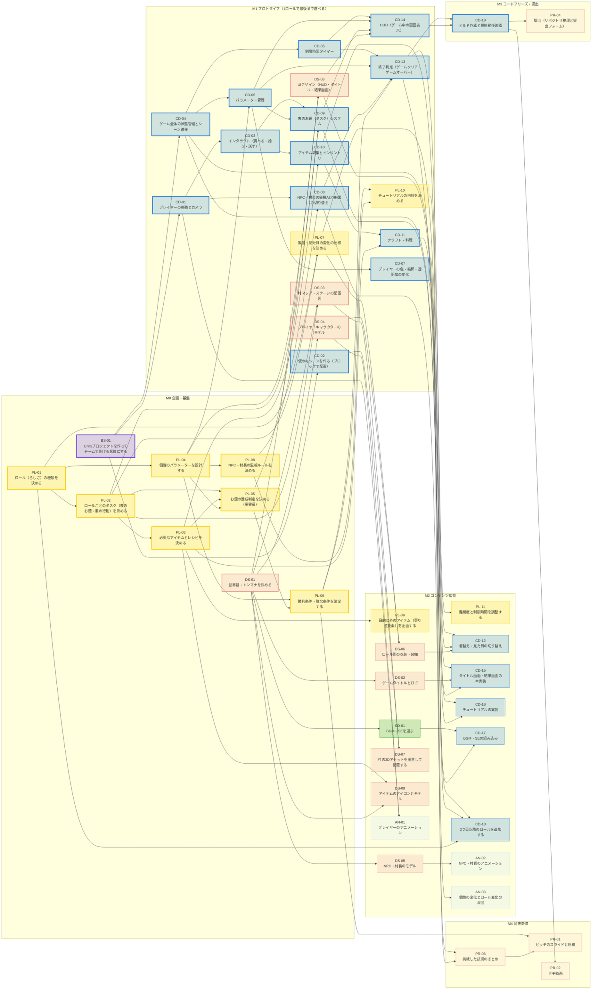

# タスク一覧

> このファイルは `tools/tasks.json` から `python3 tools/build_tasks_md.py` で作っています。直接編集せず tasks.json を直してください。
> GitHub に登録した後は、Issue と Project ボードの方が最新です。

全 48 タスク（P0: 30 / P1: 16 / P2: 2）

## 見方

- **前提**：このタスクを始める前に終わっているとよいタスク。終わっていなければ仮のもので進めてよい。
- **後続**：このタスクが終わるのを待っているタスク。後続が多いものほど早めに。
- **優先度**：P0 = MVPに必須 / P1 = 入れたい / P2 = 余裕があれば
- ID の頭文字：PL = 企画、BS = 基盤、CD = コード、DS = デザイン、AN = アニメ、SD = サウンド、PR = 発表

## 担当領域

タスクを1つずつ割り振るのではなく、ひとまとまりの「担当領域」ごとに担当を決めます。領域の中のどのタスクから手をつけるかは担当者に任せます。

### ⚙️ ゲームの土台（コード）（11タスク）

プレイヤー操作、ゲーム全体の流れ、タイマー、勝ち負けの判定、ビルドと提出。ゲームが最後まで動く状態を作って守る役

| ID | タスク | 優先度 | 期間 |
|---|---|---|---|
| [BS-01](#bs-01) | Unityプロジェクトを作ってチームで開ける状態にする | P0 | 11/14(土)〜11/15(日) |
| [CD-01](#cd-01) | プレイヤーの移動とカメラ | P0 | 11/16(月) |
| [CD-02](#cd-02) | 仮の村シーンを作る（ブロックで配置） | P0 | 11/16(月) |
| [CD-03](#cd-03) | インタラクト（調べる・拾う・話す） | P0 | 11/16(月)〜11/17(火) |
| [CD-04](#cd-04) | ゲーム全体の状態管理とシーン遷移 | P0 | 11/16(月) |
| [CD-05](#cd-05) | 制限時間タイマー | P0 | 11/16(月) |
| [CD-13](#cd-13) | 終了判定（ゲームクリア・ゲームオーバー） | P0 | 11/17(火) |
| [CD-16](#cd-16) | チュートリアルの実装 | P1 | 11/18(水)〜11/19(木) |
| [CD-17](#cd-17) | BGM・SEの組み込み | P1 | 11/19(木) |
| [CD-19](#cd-19) | ビルド作成と最終動作確認 | P0 | 11/20(金) |
| [PR-04](#pr-04) | 提出（リポジトリ整理と提出フォーム） | P0 | 11/20(金) |

- 他の領域から受け取るもの：CD-06, CD-08, CD-14, PL-06, PL-10, SD-01
- 他の領域に渡すもの：AN-01, CD-06, CD-08, CD-09, CD-10, CD-14, CD-15, DS-07, PL-11, PR-02

### 🎭 らしさの仕組み（コード）（8タスク）

パラメーター、色・輪郭が変わる表現、NPCの監視、お題、アイテム、クラフト、着替え、ロール追加。このゲームならではの仕組みを作る役

| ID | タスク | 優先度 | 期間 |
|---|---|---|---|
| [CD-06](#cd-06) | パラメーター管理 | P0 | 11/16(月)〜11/17(火) |
| [CD-07](#cd-07) | プレイヤーの色・輪郭・透明度の変化 | P0 | 11/17(火) |
| [CD-08](#cd-08) | NPC・村長の監視AIと表/裏の切り替え | P0 | 11/16(月)〜11/17(火) |
| [CD-09](#cd-09) | 表のお題（タスク）システム | P0 | 11/17(火) |
| [CD-10](#cd-10) | アイテム収集とインベントリ | P0 | 11/17(火) |
| [CD-11](#cd-11) | クラフト・料理 | P0 | 11/17(火) |
| [CD-12](#cd-12) | 着替え・見た目の切り替え | P1 | 11/18(水) |
| [CD-18](#cd-18) | 2つ目以降のロールを追加する | P1 | 11/18(水)〜11/19(木) |

- 他の領域から受け取るもの：CD-01, CD-03, CD-04, DS-06, PL-01, PL-02, PL-03, PL-04, PL-05, PL-07, PL-08
- 他の領域に渡すもの：AN-03, CD-13, CD-14, PR-03

### 🧍 キャラクター・アニメーション（6タスク）

プレイヤーとNPCのモデル、ロールごとの衣装、アニメーション、変化の演出

| ID | タスク | 優先度 | 期間 |
|---|---|---|---|
| [DS-04](#ds-04) | プレイヤーキャラクターのモデル | P0 | 11/16(月)〜11/17(火) |
| [DS-05](#ds-05) | NPC・村長のモデル | P1 | 11/17(火)〜11/18(水) |
| [DS-06](#ds-06) | ロール別の衣装・装備 | P1 | 11/17(火)〜11/18(水) |
| [AN-01](#an-01) | プレイヤーのアニメーション | P1 | 11/17(火)〜11/19(木) |
| [AN-02](#an-02) | NPC・村長のアニメーション | P2 | 11/18(水)〜11/19(木) |
| [AN-03](#an-03) | 個性の変化とロール変化の演出 | P1 | 11/18(水)〜11/19(木) |

- 他の領域から受け取るもの：CD-01, CD-07, DS-01, PL-07
- 他の領域に渡すもの：CD-12

### 🏡 世界観・マップ・UI（8タスク）

トンマナ、ロゴ、村のマップとアセット、アイテムの見た目、UIのデザインと組み込み

| ID | タスク | 優先度 | 期間 |
|---|---|---|---|
| [DS-01](#ds-01) | 世界観・トンマナを決める | P0 | 11/14(土)〜11/15(日) |
| [DS-02](#ds-02) | ゲームタイトルとロゴ | P1 | 11/17(火)〜11/18(水) |
| [DS-03](#ds-03) | 村マップ・ステージの配置図 | P0 | 11/16(月) |
| [DS-07](#ds-07) | 村の3Dアセットを用意して配置する | P1 | 11/17(火)〜11/19(木) |
| [DS-08](#ds-08) | UIデザイン（HUD・タイトル・結果画面） | P0 | 11/16(月)〜11/17(火) |
| [DS-09](#ds-09) | アイテムのアイコンとモデル | P1 | 11/17(火)〜11/18(水) |
| [CD-14](#cd-14) | HUD（ゲーム中の画面表示） | P0 | 11/17(火) |
| [CD-15](#cd-15) | タイトル画面・結果画面の本実装 | P1 | 11/18(水)〜11/19(木) |

- 他の領域から受け取るもの：CD-02, CD-04, CD-05, CD-06, CD-09, PL-02, PL-03, PL-04
- 他の領域に渡すもの：CD-19, DS-04, DS-05, SD-01

### 📝 企画・サウンド・発表（15タスク）

ロール・お題・アイテム・パラメーターなどの仕様のまとめ役（決めるのは全員で）、BGM・SE、ピッチ資料、デモ動画

| ID | タスク | 優先度 | 期間 |
|---|---|---|---|
| [PL-01](#pl-01) | ロール（らしさ）の種類を決める | P0 | 11/14(土)〜11/15(日) |
| [PL-02](#pl-02) | ロールごとのタスク（表のお題・裏の行動）を決める | P0 | 11/14(土)〜11/15(日) |
| [PL-03](#pl-03) | 必要なアイテムとレシピを決める | P0 | 11/15(日) |
| [PL-04](#pl-04) | 個性のパラメーターを設計する | P0 | 11/14(土)〜11/15(日) |
| [PL-05](#pl-05) | お題の達成判定を決める（要審議） | P0 | 11/15(日)〜11/16(月) |
| [PL-06](#pl-06) | 勝利条件・敗北条件を確定する | P0 | 11/15(日)〜11/16(月) |
| [PL-07](#pl-07) | 服装・見た目の変化の仕様を決める | P1 | 11/16(月)〜11/17(火) |
| [PL-08](#pl-08) | NPC・村長の監視ルールを決める | P0 | 11/15(日)〜11/16(月) |
| [PL-09](#pl-09) | 目的以外のアイテム（寄り道要素）を企画する | P2 | 11/18(水) |
| [PL-10](#pl-10) | チュートリアルの内容を決める | P1 | 11/17(火) |
| [PL-11](#pl-11) | 難易度と制限時間を調整する | P1 | 11/17(火)〜11/19(木) |
| [SD-01](#sd-01) | BGM・SEを選ぶ | P1 | 11/17(火)〜11/18(水) |
| [PR-01](#pr-01) | ピッチのスライドと原稿 | P0 | 11/19(木)〜11/21(土) |
| [PR-02](#pr-02) | デモ動画 | P0 | 11/20(金)〜11/21(土) |
| [PR-03](#pr-03) | 挑戦した技術のまとめ | P0 | 11/19(木)〜11/21(土) |

- 他の領域から受け取るもの：CD-07, CD-08, CD-13, CD-19, DS-01
- 他の領域に渡すもの：CD-06, CD-08, CD-09, CD-10, CD-11, CD-12, CD-13, CD-16, CD-17, CD-18, DS-03, DS-06, DS-08, DS-09

## 一番遅れてはいけない流れ（クリティカルパス）

ここが1日遅れると、全体が1日遅れます。

**PL-01** ロール（らしさ）の種類を決める → **PL-02** ロールごとのタスク（表のお題・裏の行動）を決める → **PL-03** 必要なアイテムとレシピを決める → **PL-05** お題の達成判定を決める（要審議） → **PL-06** 勝利条件・敗北条件を確定する → **CD-13** 終了判定（ゲームクリア・ゲームオーバー） → **CD-19** ビルド作成と最終動作確認 → **PR-02** デモ動画

## マイルストーンごとの一覧

### M0 企画・基盤（〜11/16(月)）

MVPで使うロール1組・タスク・パラメーターを決め、Unityプロジェクトを全員が開ける状態にする。11/17の会議までに会議はないので、企画はDiscordとIssueのコメントで決める

| ID | タスク | 担当領域 | 優先度 | 期間 | 前提 | 後続 |
|---|---|---|---|---|---|---|
| [PL-01](#pl-01) | ロール（らしさ）の種類を決める | 📝 企画・サウンド・発表 | P0 | 11/14(土)〜11/15(日) | － | PL-02, PL-04, PL-07, CD-18 |
| [PL-02](#pl-02) | ロールごとのタスク（表のお題・裏の行動）を決める | 📝 企画・サウンド・発表 | P0 | 11/14(土)〜11/15(日) | PL-01 | PL-03, PL-05, PL-07, CD-09, DS-03 |
| [PL-03](#pl-03) | 必要なアイテムとレシピを決める | 📝 企画・サウンド・発表 | P0 | 11/15(日) | PL-02 | PL-05, PL-09, CD-10, CD-11, DS-09 |
| [PL-04](#pl-04) | 個性のパラメーターを設計する | 📝 企画・サウンド・発表 | P0 | 11/14(土)〜11/15(日) | PL-01 | PL-05, PL-06, PL-08, CD-06, DS-08 |
| [PL-05](#pl-05) | お題の達成判定を決める（要審議） 🗣 | 📝 企画・サウンド・発表 | P0 | 11/15(日)〜11/16(月) | PL-02, PL-03, PL-04 | PL-06, CD-09 |
| [PL-06](#pl-06) | 勝利条件・敗北条件を確定する | 📝 企画・サウンド・発表 | P0 | 11/15(日)〜11/16(月) | PL-04, PL-05 | PL-10, CD-13, PR-01 |
| [PL-08](#pl-08) | NPC・村長の監視ルールを決める | 📝 企画・サウンド・発表 | P0 | 11/15(日)〜11/16(月) | PL-04 | PL-10, CD-08 |
| [BS-01](#bs-01) | Unityプロジェクトを作ってチームで開ける状態にする | ⚙️ ゲームの土台（コード） | P0 | 11/14(土)〜11/15(日) | － | CD-01, CD-02, CD-04 |
| [DS-01](#ds-01) | 世界観・トンマナを決める | 🏡 世界観・マップ・UI | P0 | 11/14(土)〜11/15(日) | － | DS-02, DS-03, DS-04, DS-05, DS-08, DS-09, SD-01 |

### M1 プロトタイプ（1ロールで最後まで遊べる）（〜11/17(火)）

見た目は仮でよいので、タイトル→表/裏フェーズ→終了判定→結果まで1ロールで通しプレイできる。11/17（火）21:30の会議で全員で遊んで確認する

| ID | タスク | 担当領域 | 優先度 | 期間 | 前提 | 後続 |
|---|---|---|---|---|---|---|
| [PL-07](#pl-07) | 服装・見た目の変化の仕様を決める | 📝 企画・サウンド・発表 | P1 | 11/16(月)〜11/17(火) | PL-01, PL-02 | CD-12, DS-06 |
| [PL-10](#pl-10) | チュートリアルの内容を決める | 📝 企画・サウンド・発表 | P1 | 11/17(火) | PL-06, PL-08 | CD-16 |
| [CD-01](#cd-01) | プレイヤーの移動とカメラ | ⚙️ ゲームの土台（コード） | P0 | 11/16(月) | BS-01 | CD-03, CD-08, AN-01 |
| [CD-02](#cd-02) | 仮の村シーンを作る（ブロックで配置） | ⚙️ ゲームの土台（コード） | P0 | 11/16(月) | BS-01 | DS-07 |
| [CD-03](#cd-03) | インタラクト（調べる・拾う・話す） | ⚙️ ゲームの土台（コード） | P0 | 11/16(月)〜11/17(火) | CD-01 | CD-09, CD-10 |
| [CD-04](#cd-04) | ゲーム全体の状態管理とシーン遷移 | ⚙️ ゲームの土台（コード） | P0 | 11/16(月) | BS-01 | CD-05, CD-06, CD-15, CD-17 |
| [CD-05](#cd-05) | 制限時間タイマー | ⚙️ ゲームの土台（コード） | P0 | 11/16(月) | CD-04 | CD-13, CD-14 |
| [CD-06](#cd-06) | パラメーター管理 | 🎭 らしさの仕組み（コード） | P0 | 11/16(月)〜11/17(火) | PL-04, CD-04 | CD-07, CD-09, CD-13, CD-14 |
| [CD-07](#cd-07) | プレイヤーの色・輪郭・透明度の変化 | 🎭 らしさの仕組み（コード） | P0 | 11/17(火) | CD-06 | AN-03, PR-03 |
| [CD-08](#cd-08) | NPC・村長の監視AIと表/裏の切り替え | 🎭 らしさの仕組み（コード） | P0 | 11/16(月)〜11/17(火) | CD-01, PL-08 | CD-13, PR-03 |
| [CD-09](#cd-09) | 表のお題（タスク）システム | 🎭 らしさの仕組み（コード） | P0 | 11/17(火) | CD-03, CD-06, PL-02, PL-05 | CD-14, CD-18 |
| [CD-10](#cd-10) | アイテム収集とインベントリ | 🎭 らしさの仕組み（コード） | P0 | 11/17(火) | CD-03, PL-03 | CD-11, CD-12 |
| [CD-11](#cd-11) | クラフト・料理 | 🎭 らしさの仕組み（コード） | P0 | 11/17(火) | CD-10, PL-03 | CD-18 |
| [CD-13](#cd-13) | 終了判定（ゲームクリア・ゲームオーバー） | ⚙️ ゲームの土台（コード） | P0 | 11/17(火) | CD-05, CD-06, CD-08, PL-06 | PL-11, CD-16, CD-19 |
| [CD-14](#cd-14) | HUD（ゲーム中の画面表示） | 🏡 世界観・マップ・UI | P0 | 11/17(火) | CD-05, CD-06, CD-09, DS-08 | CD-19 |
| [DS-03](#ds-03) | 村マップ・ステージの配置図 | 🏡 世界観・マップ・UI | P0 | 11/16(月) | DS-01, PL-02 | DS-07 |
| [DS-04](#ds-04) | プレイヤーキャラクターのモデル | 🧍 キャラクター・アニメーション | P0 | 11/16(月)〜11/17(火) | DS-01 | DS-06, AN-01 |
| [DS-08](#ds-08) | UIデザイン（HUD・タイトル・結果画面） | 🏡 世界観・マップ・UI | P0 | 11/16(月)〜11/17(火) | DS-01, PL-04 | CD-14, CD-15 |

### M2 コンテンツ拡充（〜11/19(木)）

複数ロール、衣装・見た目の変化、本番アセット、サウンド、チュートリアルを入れる。11/19（木）21:30の会議で確認し、コードフリーズまでに入れるものを決める

| ID | タスク | 担当領域 | 優先度 | 期間 | 前提 | 後続 |
|---|---|---|---|---|---|---|
| [PL-09](#pl-09) | 目的以外のアイテム（寄り道要素）を企画する | 📝 企画・サウンド・発表 | P2 | 11/18(水) | PL-03 | － |
| [PL-11](#pl-11) | 難易度と制限時間を調整する | 📝 企画・サウンド・発表 | P1 | 11/17(火)〜11/19(木) | CD-13 | － |
| [CD-12](#cd-12) | 着替え・見た目の切り替え | 🎭 らしさの仕組み（コード） | P1 | 11/18(水) | CD-10, PL-07, DS-06 | － |
| [CD-15](#cd-15) | タイトル画面・結果画面の本実装 | 🏡 世界観・マップ・UI | P1 | 11/18(水)〜11/19(木) | CD-04, DS-02, DS-08 | － |
| [CD-16](#cd-16) | チュートリアルの実装 | ⚙️ ゲームの土台（コード） | P1 | 11/18(水)〜11/19(木) | PL-10, CD-13 | － |
| [CD-17](#cd-17) | BGM・SEの組み込み | ⚙️ ゲームの土台（コード） | P1 | 11/19(木) | SD-01, CD-04 | － |
| [CD-18](#cd-18) | 2つ目以降のロールを追加する | 🎭 らしさの仕組み（コード） | P1 | 11/18(水)〜11/19(木) | CD-09, CD-11, PL-01 | － |
| [DS-02](#ds-02) | ゲームタイトルとロゴ | 🏡 世界観・マップ・UI | P1 | 11/17(火)〜11/18(水) | DS-01 | CD-15 |
| [DS-05](#ds-05) | NPC・村長のモデル | 🧍 キャラクター・アニメーション | P1 | 11/17(火)〜11/18(水) | DS-01 | AN-02 |
| [DS-06](#ds-06) | ロール別の衣装・装備 | 🧍 キャラクター・アニメーション | P1 | 11/17(火)〜11/18(水) | PL-07, DS-04 | CD-12 |
| [DS-07](#ds-07) | 村の3Dアセットを用意して配置する | 🏡 世界観・マップ・UI | P1 | 11/17(火)〜11/19(木) | DS-03, CD-02 | － |
| [DS-09](#ds-09) | アイテムのアイコンとモデル | 🏡 世界観・マップ・UI | P1 | 11/17(火)〜11/18(水) | PL-03, DS-01 | － |
| [AN-01](#an-01) | プレイヤーのアニメーション | 🧍 キャラクター・アニメーション | P1 | 11/17(火)〜11/19(木) | DS-04, CD-01 | － |
| [AN-02](#an-02) | NPC・村長のアニメーション | 🧍 キャラクター・アニメーション | P2 | 11/18(水)〜11/19(木) | DS-05 | － |
| [AN-03](#an-03) | 個性の変化とロール変化の演出 | 🧍 キャラクター・アニメーション | P1 | 11/18(水)〜11/19(木) | CD-07 | － |
| [SD-01](#sd-01) | BGM・SEを選ぶ | 📝 企画・サウンド・発表 | P1 | 11/17(火)〜11/18(水) | DS-01 | CD-17 |

### M3 コードフリーズ・提出（〜11/20(金)）

11/20（金）23:59 コードフリーズ。orgのリポジトリと提出フォームで提出する

| ID | タスク | 担当領域 | 優先度 | 期間 | 前提 | 後続 |
|---|---|---|---|---|---|---|
| [CD-19](#cd-19) | ビルド作成と最終動作確認 | ⚙️ ゲームの土台（コード） | P0 | 11/20(金) | CD-13, CD-14 | PR-02, PR-04 |
| [PR-04](#pr-04) | 提出（リポジトリ整理と提出フォーム） | ⚙️ ゲームの土台（コード） | P0 | 11/20(金) | CD-19 | － |

### M4 発表準備（〜11/21(土)）

11/21（土）23:59 スライド提出。11/22（日）発表（5分＋質疑3分）。挑戦した技術の詳細は必須

| ID | タスク | 担当領域 | 優先度 | 期間 | 前提 | 後続 |
|---|---|---|---|---|---|---|
| [PR-01](#pr-01) | ピッチのスライドと原稿 | 📝 企画・サウンド・発表 | P0 | 11/19(木)〜11/21(土) | PL-06, PR-03 | － |
| [PR-02](#pr-02) | デモ動画 | 📝 企画・サウンド・発表 | P0 | 11/20(金)〜11/21(土) | CD-19 | － |
| [PR-03](#pr-03) | 挑戦した技術のまとめ | 📝 企画・サウンド・発表 | P0 | 11/19(木)〜11/21(土) | CD-07, CD-08 | PR-01 |

🗣 = 要審議

## 前後関係の図

矢印は「前提 → 後続」。太枠が P0。

## 各タスクの詳細

GitHub の Issue 本文はここと同じ内容になります。

### PL-01

**[企画] ロール（らしさ）の種類を決める**　📝 企画・サウンド・発表 / P0 / M0 企画・基盤 / 11/14(土)〜11/15(日)

#### 概要
NPCから押し付けられる「〇〇らしさ」と、プレイヤーが本当になりたいロールの一覧を作る。ロールは複数ある前提だが、まずMVP用に1組を決めて先に進める。

#### やること
- [ ] 押し付けられる「らしさ」の候補を出す（例：勇者らしく、長男らしく）
- [ ] なりたいロールの候補を出す（例：鶏白湯職人、ダンサー）
- [ ] 押し付けロールとなりたいロールの組み合わせを決める
- [ ] MVPで作る1組を決める
- [ ] M2で追加するロールの優先順位を決める

#### 完了条件
ロール一覧と組み合わせが docs/game-design/roles.md にまとまり、MVPの1組が決まっている

#### 前提タスク
- なし

#### 後続タスク
- PL-02 ロールごとのタスク（表のお題・裏の行動）を決める
- PL-04 個性のパラメーターを設計する
- PL-07 服装・見た目の変化の仕様を決める
- CD-18 2つ目以降のロールを追加する

### PL-02

**[企画] ロールごとのタスク（表のお題・裏の行動）を決める**　📝 企画・サウンド・発表 / P0 / M0 企画・基盤 / 11/14(土)〜11/15(日)

#### 概要
表フェーズでNPCに求められるお題と、裏フェーズで隠れて行う行動をロールごとに決める。

#### やること
- [ ] 表のお題をロールごとに3〜5個出す（例：勇者→素振りをする）
- [ ] 裏の行動をロールごとに決める（例：鶏白湯職人→鶏ガラを集めてスープを作る）
- [ ] それぞれのお題・行動が村のどこで行われるかを書く
- [ ] MVPのロール分を先に確定する

#### 完了条件
MVPロールの表のお題と裏の行動が一覧になっている

#### 前提タスク
- PL-01 ロール（らしさ）の種類を決める

#### 後続タスク
- PL-03 必要なアイテムとレシピを決める
- PL-05 お題の達成判定を決める（要審議）
- PL-07 服装・見た目の変化の仕様を決める
- CD-09 表のお題（タスク）システム
- DS-03 村マップ・ステージの配置図

### PL-03

**[企画] 必要なアイテムとレシピを決める**　📝 企画・サウンド・発表 / P0 / M0 企画・基盤 / 11/15(日)

#### 概要
タスクに必要な素材アイテム、作るもの（料理・衣装・推しアイテム）、そのレシピを決める。

#### やること
- [ ] 素材アイテムの一覧（名前・入手場所・見た目のイメージ）
- [ ] クラフト・料理・着替えのレシピ（何を何個で何ができるか）
- [ ] ロールの完成に必要な最終アイテムを決める

#### 完了条件
MVPロールで使うアイテムとレシピが表になっている

#### 前提タスク
- PL-02 ロールごとのタスク（表のお題・裏の行動）を決める

#### 後続タスク
- PL-05 お題の達成判定を決める（要審議）
- PL-09 目的以外のアイテム（寄り道要素）を企画する
- CD-10 アイテム収集とインベントリ
- CD-11 クラフト・料理
- DS-09 アイテムのアイコンとモデル

### PL-04

**[企画] 個性のパラメーターを設計する**　📝 企画・サウンド・発表 / P0 / M0 企画・基盤 / 11/14(土)〜11/15(日)

#### 概要
ゲーム中に増減する数値を決める。勝敗や見た目の変化はすべてこの数値で判定する。

#### やること
- [ ] パラメーターの種類を決める（案：個性の濃さ／村の平和度／なりたいロールへの進み具合）
- [ ] それぞれの初期値・最大値・増減する行動を決める
- [ ] 個性の濃さとプレイヤーの見た目（色・輪郭・透明度）の対応を決める
- [ ] 最初は仮の数値でよい（調整は PL-11 で行う）

#### 完了条件
パラメーター一覧と、どの行動で何がどれだけ増減するかの表がある

#### 前提タスク
- PL-01 ロール（らしさ）の種類を決める

#### 後続タスク
- PL-05 お題の達成判定を決める（要審議）
- PL-06 勝利条件・敗北条件を確定する
- PL-08 NPC・村長の監視ルールを決める
- CD-06 パラメーター管理
- DS-08 UIデザイン（HUD・タイトル・結果画面）

### PL-05

**[企画] お題の達成判定を決める（要審議）**　📝 企画・サウンド・発表 / P0 / M0 企画・基盤 / 11/15(日)〜11/16(月)　`要審議`

#### 概要
お題をどれくらい「らしく」こなせたかをどう判定するか決める。タスクとアイテムの内容によって変わるので、それらが決まってから審議する。

#### やること
- [ ] 判定方式の案を出す（例：完了したかどうかだけ／かかった時間／決められた手順どおりか）
- [ ] MVPのお題ごとに判定方法を決める
- [ ] 判定結果がどのパラメーターにどう影響するかを決める

#### 完了条件
MVPのお題すべてに判定方法と、パラメーターへの影響が決まっている

#### 前提タスク
- PL-02 ロールごとのタスク（表のお題・裏の行動）を決める
- PL-03 必要なアイテムとレシピを決める
- PL-04 個性のパラメーターを設計する

#### 後続タスク
- PL-06 勝利条件・敗北条件を確定する
- CD-09 表のお題（タスク）システム

### PL-06

**[企画] 勝利条件・敗北条件を確定する**　📝 企画・サウンド・発表 / P0 / M0 企画・基盤 / 11/15(日)〜11/16(月)

#### 概要
クリアとゲームオーバーの条件を数値で決める。個性を失いすぎた場合は、状況によってゲームオーバーにつながるようにする。

#### やること
- [ ] 勝利条件：制限時間内に、透明にならず、気づかれずに、なりたいロールへの変化条件を満たす
- [ ] 敗北条件：らしくない行動を見られて平和度が0／時間切れ／個性が消えきる
- [ ] 個性を失いすぎたときの扱いを決める（いきなりゲームオーバーか、デバフを挟むか）
- [ ] それぞれをパラメーターの値で書き直す

#### 完了条件
勝利・敗北条件がすべてパラメーターの値で書かれている

#### 前提タスク
- PL-04 個性のパラメーターを設計する
- PL-05 お題の達成判定を決める（要審議）

#### 後続タスク
- PL-10 チュートリアルの内容を決める
- CD-13 終了判定（ゲームクリア・ゲームオーバー）
- PR-01 ピッチのスライドと原稿

### PL-07

**[企画] 服装・見た目の変化の仕様を決める**　📝 企画・サウンド・発表 / P1 / M1 プロトタイプ（1ロールで最後まで遊べる） / 11/16(月)〜11/17(火)

#### 概要
服装はタスクを進める中で選べる想定。いつ・何を選べて、見た目がどう変わるかを決める。

#### やること
- [ ] 服を手に入れる・選ぶタイミングを決める
- [ ] ロールごとの衣装・装備の候補を出す
- [ ] 見た目の変化の段階を決める（例：初期の霧／村人の制服 → 色がつく → ロールの衣装）
- [ ] 服が能力やパラメーターに影響するかを決める

#### 完了条件
見た目の変化の段階と、各段階の衣装リストがある

#### 前提タスク
- PL-01 ロール（らしさ）の種類を決める
- PL-02 ロールごとのタスク（表のお題・裏の行動）を決める

#### 後続タスク
- CD-12 着替え・見た目の切り替え
- DS-06 ロール別の衣装・装備

### PL-08

**[企画] NPC・村長の監視ルールを決める**　📝 企画・サウンド・発表 / P0 / M0 企画・基盤 / 11/15(日)〜11/16(月)

#### 概要
表フェーズと裏フェーズの境目になる「見られているかどうか」のルールを決める。

#### やること
- [ ] NPC・村長の人数と役割
- [ ] 視界の範囲（距離・角度）と巡回のしかた
- [ ] 見られているときにらしくない行動をしたらどうなるか
- [ ] 表と裏の切り替えを、見られているかどうかで自動にするか、プレイヤーが操作するかを決める

#### 完了条件
監視の仕様と、表/裏の切り替えルールが文章になっている

#### 前提タスク
- PL-04 個性のパラメーターを設計する

#### 後続タスク
- PL-10 チュートリアルの内容を決める
- CD-08 NPC・村長の監視AIと表/裏の切り替え

### PL-09

**[企画] 目的以外のアイテム（寄り道要素）を企画する**　📝 企画・サウンド・発表 / P2 / M2 コンテンツ拡充 / 11/18(水)

#### 概要
クリアに直接関係しないアイテムを入れるかを考える。探索を楽しくする、ミスリードになる、などの役割を決める。

#### やること
- [ ] 寄り道アイテムの案を出す
- [ ] 入れる場合の役割を決める（コレクション要素・ハズレ・別ロールのヒントなど）
- [ ] 入れるかどうか決める

#### 完了条件
入れるかどうかと、入れる場合のアイテム一覧が決まっている

#### 前提タスク
- PL-03 必要なアイテムとレシピを決める

#### 後続タスク
- なし

### PL-10

**[企画] チュートリアルの内容を決める**　📝 企画・サウンド・発表 / P1 / M1 プロトタイプ（1ロールで最後まで遊べる） / 11/17(火)

#### 概要
初めて遊ぶ人（審査員含む）が1分ほどでルールを理解できる流れを決める。

#### やること
- [ ] 最初に伝えること（押し付けられたらしさ・表と裏・勝利条件）を絞る
- [ ] 操作説明の順番を決める
- [ ] テキストか、実際に動かして覚える形かを決める

#### 完了条件
チュートリアルの台本（画面ごとの文章と操作）がある

#### 前提タスク
- PL-06 勝利条件・敗北条件を確定する
- PL-08 NPC・村長の監視ルールを決める

#### 後続タスク
- CD-16 チュートリアルの実装

### PL-11

**[企画] 難易度と制限時間を調整する**　📝 企画・サウンド・発表 / P1 / M2 コンテンツ拡充 / 11/17(火)〜11/19(木)

#### 概要
プロトタイプを実際に遊んでから、制限時間・パラメーターの増減量・監視の厳しさを調整する。

#### やること
- [ ] チーム全員で通しプレイして感想を集める
- [ ] 制限時間を決める（発表で見せやすい長さも考える）
- [ ] パラメーターの増減量を調整する
- [ ] 難易度を分けるかどうかを決める

#### 完了条件
初見の人が1回目で負け、2〜3回目でクリアできるくらいに調整されている

#### 前提タスク
- CD-13 終了判定（ゲームクリア・ゲームオーバー）

#### 後続タスク
- なし

### BS-01

**[基盤] Unityプロジェクトを作ってチームで開ける状態にする**　⚙️ ゲームの土台（コード） / P0 / M0 企画・基盤 / 11/14(土)〜11/15(日)

#### 概要
Unityのバージョンを揃えてプロジェクトを作り、全員がcloneして開ける状態にする。チーム開発で一番トラブルが起きやすいところなので最初にやる。

#### やること
- [ ] Unityのバージョンを決めて全員で揃える（Unity Hubで同じLTSを入れる）
- [ ] 3Dのテンプレート（URP）でプロジェクトをリポジトリ直下に作る
- [ ] .gitignore / .gitattributes が効いていることを確認する（Library/ などが上がらない）
- [ ] Editor設定で Asset Serialization を Force Text、Version Control を Visible Meta Files にする
- [ ] Assets/ 以下のフォルダ構成を docs/workflow.md のとおり作る
- [ ] 全員がcloneして開けることを確認する

#### 完了条件
全員の手元で同じプロジェクトが開け、空のシーンが再生できる

#### 前提タスク
- なし

#### 後続タスク
- CD-01 プレイヤーの移動とカメラ
- CD-02 仮の村シーンを作る（ブロックで配置）
- CD-04 ゲーム全体の状態管理とシーン遷移

### CD-01

**[コード] プレイヤーの移動とカメラ**　⚙️ ゲームの土台（コード） / P0 / M1 プロトタイプ（1ロールで最後まで遊べる） / 11/16(月)

#### 概要
村を歩き回るためのプレイヤー操作とカメラを作る。見た目はカプセルなど仮でよい。

#### やること
- [ ] キーボード（WASD）で移動、必要ならジャンプ
- [ ] カメラの方式を決めて実装（見下ろし or 三人称）
- [ ] Prefab化して他のシーンでも使えるようにする

#### 完了条件
テスト用シーンで仮のプレイヤーを動かせる

#### 前提タスク
- BS-01 Unityプロジェクトを作ってチームで開ける状態にする

#### 後続タスク
- CD-03 インタラクト（調べる・拾う・話す）
- CD-08 NPC・村長の監視AIと表/裏の切り替え
- AN-01 プレイヤーのアニメーション

### CD-02

**[コード] 仮の村シーンを作る（ブロックで配置）**　⚙️ ゲームの土台（コード） / P0 / M1 プロトタイプ（1ロールで最後まで遊べる） / 11/16(月)

#### 概要
本番の見た目ができる前に、箱や板で村のレイアウトを作って動作確認に使う。

#### やること
- [ ] 地面・建物・お題/素材のある場所を箱で置く
- [ ] ステージデザイン（DS-03）ができたら配置を合わせる

#### 完了条件
プレイヤーが歩ける仮の村シーンがある

#### 前提タスク
- BS-01 Unityプロジェクトを作ってチームで開ける状態にする

#### 後続タスク
- DS-07 村の3Dアセットを用意して配置する

### CD-03

**[コード] インタラクト（調べる・拾う・話す）**　⚙️ ゲームの土台（コード） / P0 / M1 プロトタイプ（1ロールで最後まで遊べる） / 11/16(月)〜11/17(火)

#### 概要
近くの物やNPCに対してボタンで行動できる仕組みを作る。お題・収集・会話の土台になる。

#### やること
- [ ] 近くにあるインタラクト対象を検出してUIで知らせる
- [ ] 共通のインターフェース（例：IInteractable）を作り、拾う・調べる・話すを実装
- [ ] 他の人が新しい対象を足しやすい形にする

#### 完了条件
アイテムを拾う・NPCに話しかけることができる

#### 前提タスク
- CD-01 プレイヤーの移動とカメラ

#### 後続タスク
- CD-09 表のお題（タスク）システム
- CD-10 アイテム収集とインベントリ

### CD-04

**[コード] ゲーム全体の状態管理とシーン遷移**　⚙️ ゲームの土台（コード） / P0 / M1 プロトタイプ（1ロールで最後まで遊べる） / 11/16(月)

#### 概要
タイトル → ゲーム本編 → 結果（クリア/ゲームオーバー）→ タイトル の流れを管理する仕組みを作る。

#### やること
- [ ] GameManager（状態：タイトル／プレイ中／終了）を作る
- [ ] シーン遷移の仕組みを作る
- [ ] 仮のタイトル画面・結果画面でつなげる

#### 完了条件
タイトル→本編→結果→タイトルを仮画面で一周できる

#### 前提タスク
- BS-01 Unityプロジェクトを作ってチームで開ける状態にする

#### 後続タスク
- CD-05 制限時間タイマー
- CD-06 パラメーター管理
- CD-15 タイトル画面・結果画面の本実装
- CD-17 BGM・SEの組み込み

### CD-05

**[コード] 制限時間タイマー**　⚙️ ゲームの土台（コード） / P0 / M1 プロトタイプ（1ロールで最後まで遊べる） / 11/16(月)

#### 概要
ゲームの残り時間を管理し、時間切れを通知する。

#### やること
- [ ] 残り時間のカウント
- [ ] 時間切れのイベントを出す
- [ ] 制限時間は後で調整できるよう設定値にする

#### 完了条件
時間切れで終了判定にイベントが届く

#### 前提タスク
- CD-04 ゲーム全体の状態管理とシーン遷移

#### 後続タスク
- CD-13 終了判定（ゲームクリア・ゲームオーバー）
- CD-14 HUD（ゲーム中の画面表示）

### CD-06

**[コード] パラメーター管理**　🎭 らしさの仕組み（コード） / P0 / M1 プロトタイプ（1ロールで最後まで遊べる） / 11/16(月)〜11/17(火)

#### 概要
PL-04 で決めた個性の濃さ・平和度・ロールへの進み具合などを管理する仕組みを作る。

#### やること
- [ ] パラメーターを保持するクラスを作る
- [ ] 値が変わったときにイベントを出す（UIや見た目が購読する）
- [ ] 増減量は ScriptableObject などで外から調整できるようにする

#### 完了条件
他の処理からパラメーターを増減でき、変化をUIや見た目が受け取れる

#### 前提タスク
- PL-04 個性のパラメーターを設計する
- CD-04 ゲーム全体の状態管理とシーン遷移

#### 後続タスク
- CD-07 プレイヤーの色・輪郭・透明度の変化
- CD-09 表のお題（タスク）システム
- CD-13 終了判定（ゲームクリア・ゲームオーバー）
- CD-14 HUD（ゲーム中の画面表示）

### CD-07

**[コード] プレイヤーの色・輪郭・透明度の変化**　🎭 らしさの仕組み（コード） / P0 / M1 プロトタイプ（1ロールで最後まで遊べる） / 11/17(火)

#### 概要
このゲームの核になる見た目。個性が薄いと透明・無個性に、濃いと色づいてはっきりした輪郭になる表現をシェーダーかマテリアルで作る。

#### やること
- [ ] 個性の濃さに合わせて色の濃さ・透明度・輪郭線を変える
- [ ] デザイン担当と見た目をすり合わせる
- [ ] 仮モデルで動けばよい。本番モデルは DS-04 ができたら差し替える

#### 完了条件
パラメーターを動かすとプレイヤーの見た目が変わる

#### 前提タスク
- CD-06 パラメーター管理

#### 後続タスク
- AN-03 個性の変化とロール変化の演出
- PR-03 挑戦した技術のまとめ

### CD-08

**[コード] NPC・村長の監視AIと表/裏の切り替え**　🎭 らしさの仕組み（コード） / P0 / M1 プロトタイプ（1ロールで最後まで遊べる） / 11/16(月)〜11/17(火)

#### 概要
NPCが村を巡回し、視界にプレイヤーがいるかを判定する。見られているかどうかで表フェーズと裏フェーズを切り替える。

#### やること
- [ ] NavMeshを使った巡回
- [ ] 視界判定（距離・角度・遮蔽物）
- [ ] 見られている状態をプレイヤーにわかるように出す（アイコンなど）
- [ ] 見られている間にらしくない行動をしたらパラメーターに反映

#### 完了条件
NPCに見られている/いないで表と裏が切り替わり、見つかると平和度が下がる

#### 前提タスク
- CD-01 プレイヤーの移動とカメラ
- PL-08 NPC・村長の監視ルールを決める

#### 後続タスク
- CD-13 終了判定（ゲームクリア・ゲームオーバー）
- PR-03 挑戦した技術のまとめ

### CD-09

**[コード] 表のお題（タスク）システム**　🎭 らしさの仕組み（コード） / P0 / M1 プロトタイプ（1ロールで最後まで遊べる） / 11/17(火)

#### 概要
NPCから出されるお題を受けてこなす仕組み。こなすと平和度は保たれるが個性は薄くなる。

#### やること
- [ ] お題をデータ（ScriptableObject）で定義できるようにする
- [ ] お題の受注・進行・完了
- [ ] PL-05 の判定方法で達成度を出し、パラメーターに反映
- [ ] ロールを追加するときはデータを足すだけで済む形にする

#### 完了条件
MVPロールのお題をこなすとパラメーターが変わる

#### 前提タスク
- CD-03 インタラクト（調べる・拾う・話す）
- CD-06 パラメーター管理
- PL-02 ロールごとのタスク（表のお題・裏の行動）を決める
- PL-05 お題の達成判定を決める（要審議）

#### 後続タスク
- CD-14 HUD（ゲーム中の画面表示）
- CD-18 2つ目以降のロールを追加する

### CD-10

**[コード] アイテム収集とインベントリ**　🎭 らしさの仕組み（コード） / P0 / M1 プロトタイプ（1ロールで最後まで遊べる） / 11/17(火)

#### 概要
裏フェーズでマップから素材を集めて持っておく仕組み。

#### やること
- [ ] アイテムをデータ（ScriptableObject）で定義
- [ ] 拾ったアイテムを持ち物に追加
- [ ] 持ち物の一覧表示（仮UIでよい）

#### 完了条件
マップのアイテムを拾って持ち物で確認できる

#### 前提タスク
- CD-03 インタラクト（調べる・拾う・話す）
- PL-03 必要なアイテムとレシピを決める

#### 後続タスク
- CD-11 クラフト・料理
- CD-12 着替え・見た目の切り替え

### CD-11

**[コード] クラフト・料理**　🎭 らしさの仕組み（コード） / P0 / M1 プロトタイプ（1ロールで最後まで遊べる） / 11/17(火)

#### 概要
集めた素材からレシピに沿ってアイテムを作る。作るとなりたいロールへの進み具合が上がる。

#### やること
- [ ] レシピをデータで定義
- [ ] 素材がそろったら作れる
- [ ] 完成時にパラメーターへ反映

#### 完了条件
MVPロールの最終アイテムまで作れる

#### 前提タスク
- CD-10 アイテム収集とインベントリ
- PL-03 必要なアイテムとレシピを決める

#### 後続タスク
- CD-18 2つ目以降のロールを追加する

### CD-12

**[コード] 着替え・見た目の切り替え**　🎭 らしさの仕組み（コード） / P1 / M2 コンテンツ拡充 / 11/18(水)

#### 概要
手に入れた服を選んで着替え、プレイヤーの見た目を切り替える。

#### やること
- [ ] 衣装パーツの付け替えの仕組み
- [ ] 着替えの選択UI
- [ ] PL-07 で決めた見た目の段階に合わせて切り替える

#### 完了条件
タスクの途中で服を選び、見た目が変わる

#### 前提タスク
- CD-10 アイテム収集とインベントリ
- PL-07 服装・見た目の変化の仕様を決める
- DS-06 ロール別の衣装・装備

#### 後続タスク
- なし

### CD-13

**[コード] 終了判定（ゲームクリア・ゲームオーバー）**　⚙️ ゲームの土台（コード） / P0 / M1 プロトタイプ（1ロールで最後まで遊べる） / 11/17(火)

#### 概要
PL-06 で決めた条件で勝敗を判定し、結果画面へ移る。ここまでできればプロトタイプ完成。

#### やること
- [ ] 勝利条件の判定
- [ ] 敗北条件（平和度0／時間切れ／個性が消えきる）の判定
- [ ] 結果画面に、どの条件で終わったかを渡す

#### 完了条件
1ロールでタイトルから結果まで通しで遊べる

#### 前提タスク
- CD-05 制限時間タイマー
- CD-06 パラメーター管理
- CD-08 NPC・村長の監視AIと表/裏の切り替え
- PL-06 勝利条件・敗北条件を確定する

#### 後続タスク
- PL-11 難易度と制限時間を調整する
- CD-16 チュートリアルの実装
- CD-19 ビルド作成と最終動作確認

### CD-14

**[コード] HUD（ゲーム中の画面表示）**　🏡 世界観・マップ・UI / P0 / M1 プロトタイプ（1ロールで最後まで遊べる） / 11/17(火)

#### 概要
残り時間・パラメーター・今のお題・見られているかどうかを画面に出す。

#### やること
- [ ] 最初は仮のUIで表示だけ作る
- [ ] DS-08 のデザインができたら差し替える

#### 完了条件
プレイ中に必要な情報がすべて画面で確認できる

#### 前提タスク
- CD-05 制限時間タイマー
- CD-06 パラメーター管理
- CD-09 表のお題（タスク）システム
- DS-08 UIデザイン（HUD・タイトル・結果画面）

#### 後続タスク
- CD-19 ビルド作成と最終動作確認

### CD-15

**[コード] タイトル画面・結果画面の本実装**　🏡 世界観・マップ・UI / P1 / M2 コンテンツ拡充 / 11/18(水)〜11/19(木)

#### 概要
仮で作ったタイトル・結果画面をデザインに合わせて作り込む。

#### やること
- [ ] ロゴと背景を入れたタイトル画面
- [ ] クリア/ゲームオーバーで内容が変わる結果画面（なれたロール、残った個性など）

#### 完了条件
デザインどおりのタイトル・結果画面になっている

#### 前提タスク
- CD-04 ゲーム全体の状態管理とシーン遷移
- DS-02 ゲームタイトルとロゴ
- DS-08 UIデザイン（HUD・タイトル・結果画面）

#### 後続タスク
- なし

### CD-16

**[コード] チュートリアルの実装**　⚙️ ゲームの土台（コード） / P1 / M2 コンテンツ拡充 / 11/18(水)〜11/19(木)

#### 概要
PL-10 の台本どおりにチュートリアルを組み込む。

#### やること
- [ ] 説明の表示
- [ ] 操作できたら次へ進む仕組み
- [ ] 2回目以降はスキップできるようにする

#### 完了条件
初めての人がチュートリアルだけで遊び方がわかる

#### 前提タスク
- PL-10 チュートリアルの内容を決める
- CD-13 終了判定（ゲームクリア・ゲームオーバー）

#### 後続タスク
- なし

### CD-17

**[コード] BGM・SEの組み込み**　⚙️ ゲームの土台（コード） / P1 / M2 コンテンツ拡充 / 11/19(木)

#### 概要
選んだBGM・SEをゲームに入れる。

#### やること
- [ ] 場面ごとのBGM切り替え（タイトル／表／裏／結果）
- [ ] 行動ごとのSE
- [ ] 音量バランスの調整

#### 完了条件
通しプレイで音が鳴る

#### 前提タスク
- SD-01 BGM・SEを選ぶ
- CD-04 ゲーム全体の状態管理とシーン遷移

#### 後続タスク
- なし

### CD-18

**[コード] 2つ目以降のロールを追加する**　🎭 らしさの仕組み（コード） / P1 / M2 コンテンツ拡充 / 11/18(水)〜11/19(木)

#### 概要
ロールは複数ある想定。MVPの仕組みを使って、PL-01 で決めた追加ロールを入れる。

#### やること
- [ ] 追加ロールのお題・アイテム・レシピをデータで作る
- [ ] ロールの選び方を決めて実装（最初に選ぶ／行動で決まる など）
- [ ] 必要ならマップに素材やお題の場所を足す

#### 完了条件
2つ以上のロールでクリアまで遊べる

#### 前提タスク
- CD-09 表のお題（タスク）システム
- CD-11 クラフト・料理
- PL-01 ロール（らしさ）の種類を決める

#### 後続タスク
- なし

### CD-19

**[コード] ビルド作成と最終動作確認**　⚙️ ゲームの土台（コード） / P0 / M3 コードフリーズ・提出 / 11/20(金)

#### 概要
発表で動かすビルドを作り、通しで問題がないか確認する。11/20いっぱいでコードフリーズ。

#### やること
- [ ] 発表で使うPC向けにビルドする（Windows / Mac）
- [ ] 発表用PCで動くことを確認する
- [ ] 致命的なバグだけ直す（新機能は入れない）
- [ ] コードフリーズしたコミットにタグをつける

#### 完了条件
発表用PCでビルドが最後まで遊べる

#### 前提タスク
- CD-13 終了判定（ゲームクリア・ゲームオーバー）
- CD-14 HUD（ゲーム中の画面表示）

#### 後続タスク
- PR-02 デモ動画
- PR-04 提出（リポジトリ整理と提出フォーム）

### DS-01

**[デザイン] 世界観・トンマナを決める**　🏡 世界観・マップ・UI / P0 / M0 企画・基盤 / 11/14(土)〜11/15(日)

#### 概要
メンバーの好きなものを混ぜた世界観を、見た目のルールに落とし込む。以降のデザイン作業はすべてこれに合わせる。

#### やること
- [ ] 参考画像をまとめる（Miroのスクショなど）
- [ ] 3Dの画風を決める（ローポリ、トゥーン調 など）
- [ ] カラーパレットを決める（無個性の色と、個性の色の対比）
- [ ] フォントの方向性を決める

#### 完了条件
トンマナを1枚にまとめた資料がある

#### 前提タスク
- なし

#### 後続タスク
- DS-02 ゲームタイトルとロゴ
- DS-03 村マップ・ステージの配置図
- DS-04 プレイヤーキャラクターのモデル
- DS-05 NPC・村長のモデル
- DS-08 UIデザイン（HUD・タイトル・結果画面）
- DS-09 アイテムのアイコンとモデル
- SD-01 BGM・SEを選ぶ

### DS-02

**[デザイン] ゲームタイトルとロゴ**　🏡 世界観・マップ・UI / P1 / M2 コンテンツ拡充 / 11/17(火)〜11/18(水)

#### 概要
ゲームの名前を決めてロゴを作る。タイトル画面とピッチ資料で使う。

#### やること
- [ ] タイトル案を出して決める
- [ ] ロゴを作る（透過PNG）

#### 完了条件
ロゴ画像がリポジトリに入っている

#### 前提タスク
- DS-01 世界観・トンマナを決める

#### 後続タスク
- CD-15 タイトル画面・結果画面の本実装

### DS-03

**[デザイン] 村マップ・ステージの配置図**　🏡 世界観・マップ・UI / P0 / M1 プロトタイプ（1ロールで最後まで遊べる） / 11/16(月)

#### 概要
村のどこに何があるか、NPCがどこを巡回し、どこが死角になるかを配置図にする。

#### やること
- [ ] 村の広さと主な場所（広場・家・畑・森 など）
- [ ] お題の場所・素材の場所
- [ ] NPCの巡回ルートと死角
- [ ] 上から見た図で描く（手書きでもよい）

#### 完了条件
配置図があり、CD-02 の仮シーンに反映されている

#### 前提タスク
- DS-01 世界観・トンマナを決める
- PL-02 ロールごとのタスク（表のお題・裏の行動）を決める

#### 後続タスク
- DS-07 村の3Dアセットを用意して配置する

### DS-04

**[デザイン] プレイヤーキャラクターのモデル**　🧍 キャラクター・アニメーション / P0 / M1 プロトタイプ（1ロールで最後まで遊べる） / 11/16(月)〜11/17(火)

#### 概要
霧のようにぼやけた／村人の制服を着た、初期状態のプレイヤーを作る。色や輪郭が変わる前提で作る。

#### やること
- [ ] デザイン案
- [ ] モデルを作る or 素材を探す（ライセンス確認）
- [ ] Humanoidリグにしてアニメーションを付けられるようにする
- [ ] CD-07 の見た目変化が乗るかコード担当と確認する

#### 完了条件
Unityに入っていて、仮のカプセルと差し替えられる

#### 前提タスク
- DS-01 世界観・トンマナを決める

#### 後続タスク
- DS-06 ロール別の衣装・装備
- AN-01 プレイヤーのアニメーション

### DS-05

**[デザイン] NPC・村長のモデル**　🧍 キャラクター・アニメーション / P1 / M2 コンテンツ拡充 / 11/17(火)〜11/18(水)

#### 概要
らしさを押し付けてくる村人たちと村長を作る。

#### やること
- [ ] 村長と村人のデザイン
- [ ] モデルを作る or 素材を探す（ライセンス確認）

#### 完了条件
NPCがUnityに入っていて、CD-08 のNPCと差し替えられる

#### 前提タスク
- DS-01 世界観・トンマナを決める

#### 後続タスク
- AN-02 NPC・村長のアニメーション

### DS-06

**[デザイン] ロール別の衣装・装備**　🧍 キャラクター・アニメーション / P1 / M2 コンテンツ拡充 / 11/17(火)〜11/18(水)

#### 概要
なりたいロールに近づくにつれて着られる服・装備を作る。

#### やること
- [ ] PL-07 の衣装リストに沿ってデザイン
- [ ] プレイヤーモデルに合わせて作る
- [ ] MVPロールの分を先に作る

#### 完了条件
MVPロールの衣装がUnityで着せ替えられる状態になっている

#### 前提タスク
- PL-07 服装・見た目の変化の仕様を決める
- DS-04 プレイヤーキャラクターのモデル

#### 後続タスク
- CD-12 着替え・見た目の切り替え

### DS-07

**[デザイン] 村の3Dアセットを用意して配置する**　🏡 世界観・マップ・UI / P1 / M2 コンテンツ拡充 / 11/17(火)〜11/19(木)

#### 概要
仮のブロックで作った村を、本番の見た目に置き換える。

#### やること
- [ ] 建物・木・柵などのアセットを作る or 探す（ライセンス確認）
- [ ] 配置図どおりに置き換える
- [ ] ライティング・空の設定

#### 完了条件
村が本番の見た目になっている

#### 前提タスク
- DS-03 村マップ・ステージの配置図
- CD-02 仮の村シーンを作る（ブロックで配置）

#### 後続タスク
- なし

### DS-08

**[デザイン] UIデザイン（HUD・タイトル・結果画面）**　🏡 世界観・マップ・UI / P0 / M1 プロトタイプ（1ロールで最後まで遊べる） / 11/16(月)〜11/17(火)

#### 概要
ゲーム中の表示と、タイトル・結果画面のデザインを作る。

#### やること
- [ ] HUD（残り時間・パラメーター・お題・見られているか）
- [ ] タイトル画面
- [ ] 結果画面（クリア/ゲームオーバー）
- [ ] パーツを切り出して Assets/_Project/Art/UI に入れる

#### 完了条件
UIパーツの画像がそろい、配置がわかるデザインがある

#### 前提タスク
- DS-01 世界観・トンマナを決める
- PL-04 個性のパラメーターを設計する

#### 後続タスク
- CD-14 HUD（ゲーム中の画面表示）
- CD-15 タイトル画面・結果画面の本実装

### DS-09

**[デザイン] アイテムのアイコンとモデル**　🏡 世界観・マップ・UI / P1 / M2 コンテンツ拡充 / 11/17(火)〜11/18(水)

#### 概要
素材や完成品のアイコン（持ち物画面用）と、マップに置く3Dモデルを用意する。

#### やること
- [ ] PL-03 のアイテム一覧に沿ってアイコンを作る
- [ ] マップに置くモデルを作る or 探す

#### 完了条件
MVPロールのアイテムすべてにアイコンとモデルがある

#### 前提タスク
- PL-03 必要なアイテムとレシピを決める
- DS-01 世界観・トンマナを決める

#### 後続タスク
- なし

### AN-01

**[アニメ] プレイヤーのアニメーション**　🧍 キャラクター・アニメーション / P1 / M2 コンテンツ拡充 / 11/17(火)〜11/19(木)

#### 概要
プレイヤーの基本の動きと、お題・裏の行動の動きを作る。

#### やること
- [ ] 待機・歩き・走り
- [ ] 拾う・調べる
- [ ] お題の動き（例：素振り）
- [ ] 裏の行動の動き（例：料理）
- [ ] Animator Controller を組む

#### 完了条件
プレイヤーの動きにアニメーションがついている

#### 前提タスク
- DS-04 プレイヤーキャラクターのモデル
- CD-01 プレイヤーの移動とカメラ

#### 後続タスク
- なし

### AN-02

**[アニメ] NPC・村長のアニメーション**　🧍 キャラクター・アニメーション / P2 / M2 コンテンツ拡充 / 11/18(水)〜11/19(木)

#### 概要
巡回・会話・プレイヤーに気づいたときの動きを作る。

#### やること
- [ ] 歩き・待機
- [ ] プレイヤーに気づいた・怒ったリアクション

#### 完了条件
NPCの動きにアニメーションがついている

#### 前提タスク
- DS-05 NPC・村長のモデル

#### 後続タスク
- なし

### AN-03

**[アニメ] 個性の変化とロール変化の演出**　🧍 キャラクター・アニメーション / P1 / M2 コンテンツ拡充 / 11/18(水)〜11/19(木)

#### 概要
色が薄くなる・濃くなる瞬間と、なりたいロールになれた瞬間の演出を作る。このゲームの一番の見せ場。

#### やること
- [ ] 個性が上がった/下がったときのエフェクト
- [ ] ロールに変化するときの演出（衣装が変わる、光る など）
- [ ] ゲームオーバーで消えていく演出

#### 完了条件
デモ動画で見せられる演出になっている

#### 前提タスク
- CD-07 プレイヤーの色・輪郭・透明度の変化

#### 後続タスク
- なし

### SD-01

**[サウンド] BGM・SEを選ぶ**　📝 企画・サウンド・発表 / P1 / M2 コンテンツ拡充 / 11/17(火)〜11/18(水)

#### 概要
世界観に合うBGMとSEを集める。フリー素材は必ず利用規約を確認し、クレジットを記録する。

#### やること
- [ ] BGM：タイトル／表フェーズ／裏フェーズ／クリア／ゲームオーバー
- [ ] SE：拾う・作る・見つかった・ゲージ変化・ボタン など
- [ ] 使った素材と規約を docs/credits.md に記録

#### 完了条件
音声ファイルが Assets/_Project/Audio に入り、クレジットが記録されている

#### 前提タスク
- DS-01 世界観・トンマナを決める

#### 後続タスク
- CD-17 BGM・SEの組み込み

### PR-01

**[発表] ピッチのスライドと原稿**　📝 企画・サウンド・発表 / P0 / M4 発表準備 / 11/19(木)〜11/21(土)

#### 概要
「押し付けられたらしさではなく、自分のらしさを」というメッセージが伝わるピッチを作る。発表は5分＋質疑3分。評価軸は UI/UX・新規性・技術・らしさ。スライドは11/21（土）23:59 提出。

#### やること
- [ ] 構成（課題・メッセージ → ゲーム紹介 → デモ → 挑戦した技術 → まとめ）
- [ ] 評価軸（UI/UX・新規性・技術・らしさ）それぞれに答えるページがあるか確認
- [ ] ロゴ（DS-02）ができたらスライドに入れる
- [ ] 原稿作成と、5分に収まるか時間を計って練習
- [ ] 想定質問と答えを用意する（質疑3分）
- [ ] 11/21 23:59 までにスライドを提出

#### 完了条件
スライドが提出済みで、5分で発表できる原稿がある

#### 前提タスク
- PL-06 勝利条件・敗北条件を確定する
- PR-03 挑戦した技術のまとめ

#### 後続タスク
- なし

### PR-02

**[発表] デモ動画**　📝 企画・サウンド・発表 / P0 / M4 発表準備 / 11/20(金)〜11/21(土)

#### 概要
発表で使うプレイ動画を撮って編集する。ライブデモが失敗したときの保険にもなる。

#### やること
- [ ] 見せたい場面を決める（色が抜けていく、ロールに変わる瞬間 など）
- [ ] プレイを録画
- [ ] 編集（字幕・BGM）

#### 完了条件
発表で流せる動画ファイルがある

#### 前提タスク
- CD-19 ビルド作成と最終動作確認

#### 後続タスク
- なし

### PR-03

**[発表] 挑戦した技術のまとめ**　📝 企画・サウンド・発表 / P0 / M4 発表準備 / 11/19(木)〜11/21(土)

#### 概要
発表では挑戦した技術の詳細が必須。実装した人が、何に挑戦して、どう解決したかを書き残し、スライドに使えるようにする。

#### やること
- [ ] 各自、実装で工夫・挑戦したことを docs/tech.md に書く（例：色・輪郭の変化のシェーダー、NPCの視界判定）
- [ ] うまくいかなかったことと、その解決方法も書く
- [ ] スライドに載せる図やスクリーンショットを用意する
- [ ] スライドに載せる2〜3個を選ぶ

#### 完了条件
docs/tech.md に技術の説明がまとまり、スライドに載せる内容が決まっている

#### 前提タスク
- CD-07 プレイヤーの色・輪郭・透明度の変化
- CD-08 NPC・村長の監視AIと表/裏の切り替え

#### 後続タスク
- PR-01 ピッチのスライドと原稿

### PR-04

**[発表] 提出（リポジトリ整理と提出フォーム）**　⚙️ ゲームの土台（コード） / P0 / M3 コードフリーズ・提出 / 11/20(金)

#### 概要
11/20（金）23:59 までに、orgのリポジトリと提出フォームで提出する。

#### やること
- [ ] READMEにゲームの説明・遊び方・操作方法・スクリーンショットを書く
- [ ] ビルドの置き場所（Releasesなど）を決めてREADMEにリンクする
- [ ] docs/credits.md に使った素材がすべて載っているか確認
- [ ] 提出フォームを送る

#### 完了条件
提出フォームが送信済みで、READMEを見れば審査員が遊べる

#### 前提タスク
- CD-19 ビルド作成と最終動作確認

#### 後続タスク
- なし
