# タスク一覧

> このファイルは `tools/tasks.json` と `tools/specs/` から `python3 tools/build_tasks_md.py` で作っています。直接編集せず tasks.json を直してください。
> GitHub に登録した後は、Issue と Project ボードの方が最新です。

全 56 タスク（P0: 36 / P1: 18 / P2: 2）

## 見方

- **前提**：このタスクを始める前に終わっているとよいタスク。終わっていなければ仮のもので進めてよい。
- **後続**：このタスクが終わるのを待っているタスク。後続が多いものほど早めに。
- **優先度**：P0 = MVPに必須 / P1 = 入れたい / P2 = 余裕があれば
- ID の頭文字：PL = 企画、BS = 基盤、CD = コード、DS = デザイン、AN = アニメ、SD = サウンド、PR = 発表

## 担当領域

タスクを1つずつ割り振るのではなく、ひとまとまりの「担当領域」ごとに担当を決めます。領域の中のどのタスクから手をつけるかは担当者に任せます。

### ⚙️ ゲームの土台（コード）（12タスク）

プレイヤー操作、ゲーム全体の流れ、タイマー、勝ち負けの判定、ビルドと提出。ゲームが最後まで動く状態を作って守る役

| ID | タスク | 優先度 | 期間 |
|---|---|---|---|
| [BS-01](#bs-01) | #12 Unityプロジェクトを作ってチームで開ける状態にする | P0 | 11/14(土)〜11/15(日) |
| [BS-02](#bs-02) | #49 共通の型の雛形を作る（全員が使うクラス・データ定義） | P0 | 11/15(日)〜11/16(月) |
| [CD-01](#cd-01) | #13 プレイヤーの移動とカメラ | P0 | 11/16(月) |
| [CD-02](#cd-02) | #14 仮の村シーンを作る（ブロックで配置） | P0 | 11/16(月) |
| [CD-03](#cd-03) | #15 インタラクト（調べる・拾う・話す） | P0 | 11/16(月)〜11/17(火) |
| [CD-04](#cd-04) | #16 ゲーム全体の状態管理とシーン遷移 | P0 | 11/16(月) |
| [CD-05](#cd-05) | #17 制限時間タイマー | P0 | 11/16(月) |
| [CD-13](#cd-13) | #25 終了判定（ゲームクリア・ゲームオーバー） | P0 | 11/17(火) |
| [CD-16](#cd-16) | #28 チュートリアルの実装 | P1 | 11/18(水)〜11/19(木) |
| [CD-17](#cd-17) | #29 BGM・SEの組み込み | P1 | 11/19(木) |
| [CD-19](#cd-19) | #31 ビルド作成と最終動作確認 | P0 | 11/20(金) |
| [PR-04](#pr-04) | #48 提出（リポジトリ整理と提出フォーム） | P0 | 11/20(金) |

- 他の領域から受け取るもの：CD-06, CD-08c, CD-14, PL-06, PL-10, SD-01
- 他の領域に渡すもの：AN-01, CD-06, CD-08a, CD-08b, CD-09a, CD-09b, CD-10, CD-14, CD-15, CD-20, DS-07, PL-11, PR-02

### 🎭 らしさの仕組み（コード）（14タスク）

パラメーター、色・輪郭が変わる表現、NPCの監視、お題、アイテム、クラフト、着替え、ロール追加。このゲームならではの仕組みを作る役

| ID | タスク | 優先度 | 期間 |
|---|---|---|---|
| [CD-06](#cd-06) | #18 パラメーター管理 | P0 | 11/16(月)〜11/17(火) |
| [CD-07](#cd-07) | #19 プレイヤーの色・輪郭・透明度の変化 | P0 | 11/17(火) |
| [CD-08](#cd-08) | #20 NPC・村長の監視AIと表/裏の切り替え | P0 | 11/16(月)〜11/17(火) |
| [CD-08a](#cd-08a) | #50 NPCの巡回（NavMesh） | P0 | 11/16(月) |
| [CD-08b](#cd-08b) | #51 NPCの視界判定（VisionSensor） | P0 | 11/16(月) |
| [CD-08c](#cd-08c) | #52 監視マネージャー（表/裏の切り替えと見つかったときの処理） | P0 | 11/17(火) |
| [CD-09](#cd-09) | #21 表のお題（タスク）システム | P0 | 11/17(火) |
| [CD-09a](#cd-09a) | #53 お題の進行管理（TaskManager） | P0 | 11/16(月)〜11/17(火) |
| [CD-09b](#cd-09b) | #54 お題をこなす場所とアクション（TaskSpot・納品・会話） | P0 | 11/17(火) |
| [CD-10](#cd-10) | #22 アイテム収集とインベントリ | P0 | 11/17(火) |
| [CD-11](#cd-11) | #23 クラフト・料理 | P0 | 11/17(火) |
| [CD-12](#cd-12) | #24 着替え・見た目の切り替え | P1 | 11/18(水) |
| [CD-18](#cd-18) | #30 2つ目以降のロールを追加する | P1 | 11/18(水)〜11/19(木) |
| [CD-21](#cd-21) | #56 「決められた道」ルール（入ってはいけない場所） | P1 | 11/18(水) |

- 他の領域から受け取るもの：BS-02, CD-02, CD-03, DS-06, PL-01, PL-02, PL-03, PL-04, PL-05, PL-07, PL-08
- 他の領域に渡すもの：AN-03, CD-13, CD-14, CD-20, PR-03

### 🧍 キャラクター・アニメーション（6タスク）

プレイヤーとNPCのモデル、ロールごとの衣装、アニメーション、変化の演出

| ID | タスク | 優先度 | 期間 |
|---|---|---|---|
| [DS-04](#ds-04) | #35 プレイヤーキャラクターのモデル | P0 | 11/16(月)〜11/17(火) |
| [DS-05](#ds-05) | #36 NPC・村長のモデル | P1 | 11/17(火)〜11/18(水) |
| [DS-06](#ds-06) | #37 ロール別の衣装・装備 | P1 | 11/17(火)〜11/18(水) |
| [AN-01](#an-01) | #41 プレイヤーのアニメーション | P1 | 11/17(火)〜11/19(木) |
| [AN-02](#an-02) | #42 NPC・村長のアニメーション | P2 | 11/18(水)〜11/19(木) |
| [AN-03](#an-03) | #43 個性の変化とロール変化の演出 | P1 | 11/18(水)〜11/19(木) |

- 他の領域から受け取るもの：CD-01, CD-07, DS-01, PL-07
- 他の領域に渡すもの：CD-12

### 🏡 世界観・マップ・UI（9タスク）

トンマナ、ロゴ、村のマップとアセット、アイテムの見た目、UIのデザインと組み込み

| ID | タスク | 優先度 | 期間 |
|---|---|---|---|
| [DS-01](#ds-01) | #32 世界観・トンマナを決める | P0 | 11/14(土)〜11/15(日) |
| [DS-02](#ds-02) | #33 ゲームタイトルとロゴ | P1 | 11/17(火)〜11/18(水) |
| [DS-03](#ds-03) | #34 村マップ・ステージの配置図 | P0 | 11/16(月) |
| [DS-07](#ds-07) | #38 村の3Dアセットを用意して配置する | P1 | 11/17(火)〜11/19(木) |
| [DS-08](#ds-08) | #39 UIデザイン（HUD・タイトル・結果画面） | P0 | 11/16(月)〜11/17(火) |
| [DS-09](#ds-09) | #40 アイテムのアイコンとモデル | P1 | 11/17(火)〜11/18(水) |
| [CD-14](#cd-14) | #26 HUD（ゲーム中の画面表示） | P0 | 11/17(火) |
| [CD-15](#cd-15) | #27 タイトル画面・結果画面の本実装 | P1 | 11/18(水)〜11/19(木) |
| [CD-20](#cd-20) | #55 なりたいロールを選ぶ画面 | P1 | 11/18(水)〜11/19(木) |

- 他の領域から受け取るもの：CD-02, CD-04, CD-05, CD-06, CD-08c, CD-09a, CD-18, PL-02, PL-03, PL-04
- 他の領域に渡すもの：CD-19, DS-04, DS-05, SD-01

### 📝 企画・サウンド・発表（15タスク）

ロール・お題・アイテム・パラメーターなどの仕様のまとめ役（決めるのは全員で）、BGM・SE、ピッチ資料、デモ動画

| ID | タスク | 優先度 | 期間 |
|---|---|---|---|
| [PL-01](#pl-01) | #1 ロール（らしさ）の種類を決める | P0 | 11/14(土)〜11/15(日) |
| [PL-02](#pl-02) | #2 ロールごとのタスク（表のお題・裏の行動）を決める | P0 | 11/14(土)〜11/15(日) |
| [PL-03](#pl-03) | #3 必要なアイテムとレシピを決める | P0 | 11/15(日) |
| [PL-04](#pl-04) | #4 個性のパラメーターを設計する | P0 | 11/14(土)〜11/15(日) |
| [PL-05](#pl-05) | #5 お題の達成判定を決める（要審議） | P0 | 11/15(日)〜11/16(月) |
| [PL-06](#pl-06) | #6 勝利条件・敗北条件を確定する | P0 | 11/15(日)〜11/16(月) |
| [PL-07](#pl-07) | #7 服装・見た目の変化の仕様を決める | P1 | 11/16(月)〜11/17(火) |
| [PL-08](#pl-08) | #8 NPC・村長の監視ルールを決める | P0 | 11/15(日)〜11/16(月) |
| [PL-09](#pl-09) | #9 目的以外のアイテム（寄り道要素）を企画する | P2 | 11/18(水) |
| [PL-10](#pl-10) | #10 チュートリアルの内容を決める | P1 | 11/17(火) |
| [PL-11](#pl-11) | #11 難易度と制限時間を調整する | P1 | 11/17(火)〜11/19(木) |
| [SD-01](#sd-01) | #44 BGM・SEを選ぶ | P1 | 11/17(火)〜11/18(水) |
| [PR-01](#pr-01) | #45 ピッチのスライドと原稿 | P0 | 11/19(木)〜11/21(土) |
| [PR-02](#pr-02) | #46 デモ動画 | P0 | 11/20(金)〜11/21(土) |
| [PR-03](#pr-03) | #47 挑戦した技術のまとめ | P0 | 11/19(木)〜11/21(土) |

- 他の領域から受け取るもの：CD-07, CD-08c, CD-13, CD-19, DS-01
- 他の領域に渡すもの：CD-06, CD-08c, CD-09a, CD-10, CD-11, CD-12, CD-13, CD-16, CD-17, CD-18, CD-21, DS-03, DS-06, DS-08, DS-09

## 一番遅れてはいけない流れ（クリティカルパス）

ここが1日遅れると、全体が1日遅れます。

**PL-01** ロール（らしさ）の種類を決める → **PL-02** ロールごとのタスク（表のお題・裏の行動）を決める → **PL-03** 必要なアイテムとレシピを決める → **PL-05** お題の達成判定を決める（要審議） → **PL-06** 勝利条件・敗北条件を確定する → **CD-13** 終了判定（ゲームクリア・ゲームオーバー） → **CD-19** ビルド作成と最終動作確認 → **PR-02** デモ動画

## マイルストーンごとの一覧

### M0 企画・基盤（〜11/16(月)）

MVPで使うロール1組・タスク・パラメーターを決め、Unityプロジェクトを全員が開ける状態にする。11/17の会議までに会議はないので、企画はDiscordとIssueのコメントで決める

| ID | タスク | 担当領域 | 優先度 | 期間 | 前提 | 後続 |
|---|---|---|---|---|---|---|
| [PL-01](#pl-01) | #1 ロール（らしさ）の種類を決める | 📝 企画・サウンド・発表 | P0 | 11/14(土)〜11/15(日) | － | PL-02, PL-04, PL-07, CD-18 |
| [PL-02](#pl-02) | #2 ロールごとのタスク（表のお題・裏の行動）を決める | 📝 企画・サウンド・発表 | P0 | 11/14(土)〜11/15(日) | PL-01 | PL-03, PL-05, PL-07, DS-03, CD-09a |
| [PL-03](#pl-03) | #3 必要なアイテムとレシピを決める | 📝 企画・サウンド・発表 | P0 | 11/15(日) | PL-02 | PL-05, PL-09, CD-10, CD-11, DS-09 |
| [PL-04](#pl-04) | #4 個性のパラメーターを設計する | 📝 企画・サウンド・発表 | P0 | 11/14(土)〜11/15(日) | PL-01 | PL-05, PL-06, PL-08, CD-06, DS-08 |
| [PL-05](#pl-05) | #5 お題の達成判定を決める（要審議） 🗣 | 📝 企画・サウンド・発表 | P0 | 11/15(日)〜11/16(月) | PL-02, PL-03, PL-04 | PL-06, CD-09a |
| [PL-06](#pl-06) | #6 勝利条件・敗北条件を確定する | 📝 企画・サウンド・発表 | P0 | 11/15(日)〜11/16(月) | PL-04, PL-05 | PL-10, CD-13, PR-01 |
| [PL-08](#pl-08) | #8 NPC・村長の監視ルールを決める | 📝 企画・サウンド・発表 | P0 | 11/15(日)〜11/16(月) | PL-04 | PL-10, CD-08c, CD-21 |
| [BS-01](#bs-01) | #12 Unityプロジェクトを作ってチームで開ける状態にする | ⚙️ ゲームの土台（コード） | P0 | 11/14(土)〜11/15(日) | － | CD-02, BS-02 |
| [DS-01](#ds-01) | #32 世界観・トンマナを決める | 🏡 世界観・マップ・UI | P0 | 11/14(土)〜11/15(日) | － | DS-02, DS-03, DS-04, DS-05, DS-08, DS-09, SD-01 |
| [BS-02](#bs-02) | #49 共通の型の雛形を作る（全員が使うクラス・データ定義） | ⚙️ ゲームの土台（コード） | P0 | 11/15(日)〜11/16(月) | BS-01 | CD-01, CD-04, CD-06, CD-08a, CD-08b, CD-09a |

### M1 プロトタイプ（1ロールで最後まで遊べる）（〜11/17(火)）

見た目は仮でよいので、タイトル→表/裏フェーズ→終了判定→結果まで1ロールで通しプレイできる。11/17（火）21:30の会議で全員で遊んで確認する

| ID | タスク | 担当領域 | 優先度 | 期間 | 前提 | 後続 |
|---|---|---|---|---|---|---|
| [PL-07](#pl-07) | #7 服装・見た目の変化の仕様を決める | 📝 企画・サウンド・発表 | P1 | 11/16(月)〜11/17(火) | PL-01, PL-02 | CD-12, DS-06 |
| [PL-10](#pl-10) | #10 チュートリアルの内容を決める | 📝 企画・サウンド・発表 | P1 | 11/17(火) | PL-06, PL-08 | CD-16 |
| [CD-01](#cd-01) | #13 プレイヤーの移動とカメラ | ⚙️ ゲームの土台（コード） | P0 | 11/16(月) | BS-02 | CD-03, AN-01 |
| [CD-02](#cd-02) | #14 仮の村シーンを作る（ブロックで配置） | ⚙️ ゲームの土台（コード） | P0 | 11/16(月) | BS-01 | DS-07, CD-08a |
| [CD-03](#cd-03) | #15 インタラクト（調べる・拾う・話す） | ⚙️ ゲームの土台（コード） | P0 | 11/16(月)〜11/17(火) | CD-01 | CD-10, CD-09b |
| [CD-04](#cd-04) | #16 ゲーム全体の状態管理とシーン遷移 | ⚙️ ゲームの土台（コード） | P0 | 11/16(月) | BS-02 | CD-05, CD-15, CD-17, CD-20 |
| [CD-05](#cd-05) | #17 制限時間タイマー | ⚙️ ゲームの土台（コード） | P0 | 11/16(月) | CD-04 | CD-13, CD-14 |
| [CD-06](#cd-06) | #18 パラメーター管理 | 🎭 らしさの仕組み（コード） | P0 | 11/16(月)〜11/17(火) | BS-02, PL-04 | CD-07, CD-13, CD-14, CD-08c, CD-09a |
| [CD-07](#cd-07) | #19 プレイヤーの色・輪郭・透明度の変化 | 🎭 らしさの仕組み（コード） | P0 | 11/17(火) | CD-06 | AN-03, PR-03 |
| [CD-08](#cd-08) | #20 NPC・村長の監視AIと表/裏の切り替え | 🎭 らしさの仕組み（コード） | P0 | 11/16(月)〜11/17(火) | － | － |
| [CD-09](#cd-09) | #21 表のお題（タスク）システム | 🎭 らしさの仕組み（コード） | P0 | 11/17(火) | － | － |
| [CD-10](#cd-10) | #22 アイテム収集とインベントリ | 🎭 らしさの仕組み（コード） | P0 | 11/17(火) | CD-03, PL-03 | CD-11, CD-12 |
| [CD-11](#cd-11) | #23 クラフト・料理 | 🎭 らしさの仕組み（コード） | P0 | 11/17(火) | CD-10, PL-03 | CD-18 |
| [CD-13](#cd-13) | #25 終了判定（ゲームクリア・ゲームオーバー） | ⚙️ ゲームの土台（コード） | P0 | 11/17(火) | CD-05, CD-06, CD-08c, PL-06 | PL-11, CD-16, CD-19 |
| [CD-14](#cd-14) | #26 HUD（ゲーム中の画面表示） | 🏡 世界観・マップ・UI | P0 | 11/17(火) | CD-05, CD-06, CD-09a, CD-08c, DS-08 | CD-19 |
| [DS-03](#ds-03) | #34 村マップ・ステージの配置図 | 🏡 世界観・マップ・UI | P0 | 11/16(月) | DS-01, PL-02 | DS-07 |
| [DS-04](#ds-04) | #35 プレイヤーキャラクターのモデル | 🧍 キャラクター・アニメーション | P0 | 11/16(月)〜11/17(火) | DS-01 | DS-06, AN-01 |
| [DS-08](#ds-08) | #39 UIデザイン（HUD・タイトル・結果画面） | 🏡 世界観・マップ・UI | P0 | 11/16(月)〜11/17(火) | DS-01, PL-04 | CD-14, CD-15, CD-20 |
| [CD-08a](#cd-08a) | #50 NPCの巡回（NavMesh） | 🎭 らしさの仕組み（コード） | P0 | 11/16(月) | BS-02, CD-02 | － |
| [CD-08b](#cd-08b) | #51 NPCの視界判定（VisionSensor） | 🎭 らしさの仕組み（コード） | P0 | 11/16(月) | BS-02 | CD-08c |
| [CD-08c](#cd-08c) | #52 監視マネージャー（表/裏の切り替えと見つかったときの処理） | 🎭 らしさの仕組み（コード） | P0 | 11/17(火) | CD-08b, CD-06, PL-08 | CD-13, CD-14, PR-03, CD-21 |
| [CD-09a](#cd-09a) | #53 お題の進行管理（TaskManager） | 🎭 らしさの仕組み（コード） | P0 | 11/16(月)〜11/17(火) | BS-02, CD-06, PL-02, PL-05 | CD-14, CD-09b |
| [CD-09b](#cd-09b) | #54 お題をこなす場所とアクション（TaskSpot・納品・会話） | 🎭 らしさの仕組み（コード） | P0 | 11/17(火) | CD-09a, CD-03 | CD-18 |

### M2 コンテンツ拡充（〜11/19(木)）

複数ロール、衣装・見た目の変化、本番アセット、サウンド、チュートリアルを入れる。11/19（木）21:30の会議で確認し、コードフリーズまでに入れるものを決める

| ID | タスク | 担当領域 | 優先度 | 期間 | 前提 | 後続 |
|---|---|---|---|---|---|---|
| [PL-09](#pl-09) | #9 目的以外のアイテム（寄り道要素）を企画する | 📝 企画・サウンド・発表 | P2 | 11/18(水) | PL-03 | － |
| [PL-11](#pl-11) | #11 難易度と制限時間を調整する | 📝 企画・サウンド・発表 | P1 | 11/17(火)〜11/19(木) | CD-13 | － |
| [CD-12](#cd-12) | #24 着替え・見た目の切り替え | 🎭 らしさの仕組み（コード） | P1 | 11/18(水) | CD-10, PL-07, DS-06 | － |
| [CD-15](#cd-15) | #27 タイトル画面・結果画面の本実装 | 🏡 世界観・マップ・UI | P1 | 11/18(水)〜11/19(木) | CD-04, DS-02, DS-08 | － |
| [CD-16](#cd-16) | #28 チュートリアルの実装 | ⚙️ ゲームの土台（コード） | P1 | 11/18(水)〜11/19(木) | PL-10, CD-13 | － |
| [CD-17](#cd-17) | #29 BGM・SEの組み込み | ⚙️ ゲームの土台（コード） | P1 | 11/19(木) | SD-01, CD-04 | － |
| [CD-18](#cd-18) | #30 2つ目以降のロールを追加する | 🎭 らしさの仕組み（コード） | P1 | 11/18(水)〜11/19(木) | CD-09b, CD-11, PL-01 | CD-20 |
| [DS-02](#ds-02) | #33 ゲームタイトルとロゴ | 🏡 世界観・マップ・UI | P1 | 11/17(火)〜11/18(水) | DS-01 | CD-15 |
| [DS-05](#ds-05) | #36 NPC・村長のモデル | 🧍 キャラクター・アニメーション | P1 | 11/17(火)〜11/18(水) | DS-01 | AN-02 |
| [DS-06](#ds-06) | #37 ロール別の衣装・装備 | 🧍 キャラクター・アニメーション | P1 | 11/17(火)〜11/18(水) | PL-07, DS-04 | CD-12 |
| [DS-07](#ds-07) | #38 村の3Dアセットを用意して配置する | 🏡 世界観・マップ・UI | P1 | 11/17(火)〜11/19(木) | DS-03, CD-02 | － |
| [DS-09](#ds-09) | #40 アイテムのアイコンとモデル | 🏡 世界観・マップ・UI | P1 | 11/17(火)〜11/18(水) | PL-03, DS-01 | － |
| [AN-01](#an-01) | #41 プレイヤーのアニメーション | 🧍 キャラクター・アニメーション | P1 | 11/17(火)〜11/19(木) | DS-04, CD-01 | － |
| [AN-02](#an-02) | #42 NPC・村長のアニメーション | 🧍 キャラクター・アニメーション | P2 | 11/18(水)〜11/19(木) | DS-05 | － |
| [AN-03](#an-03) | #43 個性の変化とロール変化の演出 | 🧍 キャラクター・アニメーション | P1 | 11/18(水)〜11/19(木) | CD-07 | － |
| [SD-01](#sd-01) | #44 BGM・SEを選ぶ | 📝 企画・サウンド・発表 | P1 | 11/17(火)〜11/18(水) | DS-01 | CD-17 |
| [CD-20](#cd-20) | #55 なりたいロールを選ぶ画面 | 🏡 世界観・マップ・UI | P1 | 11/18(水)〜11/19(木) | CD-04, DS-08, CD-18 | － |
| [CD-21](#cd-21) | #56 「決められた道」ルール（入ってはいけない場所） | 🎭 らしさの仕組み（コード） | P1 | 11/18(水) | CD-08c, PL-08 | － |

### M3 コードフリーズ・提出（〜11/20(金)）

11/20（金）23:59 コードフリーズ。orgのリポジトリと提出フォームで提出する

| ID | タスク | 担当領域 | 優先度 | 期間 | 前提 | 後続 |
|---|---|---|---|---|---|---|
| [CD-19](#cd-19) | #31 ビルド作成と最終動作確認 | ⚙️ ゲームの土台（コード） | P0 | 11/20(金) | CD-13, CD-14 | PR-02, PR-04 |
| [PR-04](#pr-04) | #48 提出（リポジトリ整理と提出フォーム） | ⚙️ ゲームの土台（コード） | P0 | 11/20(金) | CD-19 | － |

### M4 発表準備（〜11/21(土)）

11/21（土）23:59 スライド提出。11/22（日）発表（5分＋質疑3分）。挑戦した技術の詳細は必須

| ID | タスク | 担当領域 | 優先度 | 期間 | 前提 | 後続 |
|---|---|---|---|---|---|---|
| [PR-01](#pr-01) | #45 ピッチのスライドと原稿 | 📝 企画・サウンド・発表 | P0 | 11/19(木)〜11/21(土) | PL-06, PR-03 | － |
| [PR-02](#pr-02) | #46 デモ動画 | 📝 企画・サウンド・発表 | P0 | 11/20(金)〜11/21(土) | CD-19 | － |
| [PR-03](#pr-03) | #47 挑戦した技術のまとめ | 📝 企画・サウンド・発表 | P0 | 11/19(木)〜11/21(土) | CD-07, CD-08c | PR-01 |

🗣 = 要審議

## 前後関係の図

矢印は「前提 → 後続」。太枠が P0。

```mermaid
flowchart LR
  subgraph M0["M0 企画・基盤"]
    PL_01["PL-01<br/>ロール（らしさ）の種類を決める"]
    PL_02["PL-02<br/>ロールごとのタスク（表のお題・裏の行動）を決める"]
    PL_03["PL-03<br/>必要なアイテムとレシピを決める"]
    PL_04["PL-04<br/>個性のパラメーターを設計する"]
    PL_05["PL-05<br/>お題の達成判定を決める（要審議）"]
    PL_06["PL-06<br/>勝利条件・敗北条件を確定する"]
    PL_08["PL-08<br/>NPC・村長の監視ルールを決める"]
    BS_01["BS-01<br/>Unityプロジェクトを作ってチームで開ける状態にする"]
    DS_01["DS-01<br/>世界観・トンマナを決める"]
    BS_02["BS-02<br/>共通の型の雛形を作る（全員が使うクラス・データ定義）"]
  end
  subgraph M1["M1 プロトタイプ（1ロールで最後まで遊べる）"]
    PL_07["PL-07<br/>服装・見た目の変化の仕様を決める"]
    PL_10["PL-10<br/>チュートリアルの内容を決める"]
    CD_01["CD-01<br/>プレイヤーの移動とカメラ"]
    CD_02["CD-02<br/>仮の村シーンを作る（ブロックで配置）"]
    CD_03["CD-03<br/>インタラクト（調べる・拾う・話す）"]
    CD_04["CD-04<br/>ゲーム全体の状態管理とシーン遷移"]
    CD_05["CD-05<br/>制限時間タイマー"]
    CD_06["CD-06<br/>パラメーター管理"]
    CD_07["CD-07<br/>プレイヤーの色・輪郭・透明度の変化"]
    CD_08["CD-08<br/>NPC・村長の監視AIと表/裏の切り替え"]
    CD_09["CD-09<br/>表のお題（タスク）システム"]
    CD_10["CD-10<br/>アイテム収集とインベントリ"]
    CD_11["CD-11<br/>クラフト・料理"]
    CD_13["CD-13<br/>終了判定（ゲームクリア・ゲームオーバー）"]
    CD_14["CD-14<br/>HUD（ゲーム中の画面表示）"]
    DS_03["DS-03<br/>村マップ・ステージの配置図"]
    DS_04["DS-04<br/>プレイヤーキャラクターのモデル"]
    DS_08["DS-08<br/>UIデザイン（HUD・タイトル・結果画面）"]
    CD_08a["CD-08a<br/>NPCの巡回（NavMesh）"]
    CD_08b["CD-08b<br/>NPCの視界判定（VisionSensor）"]
    CD_08c["CD-08c<br/>監視マネージャー（表/裏の切り替えと見つかったときの処理）"]
    CD_09a["CD-09a<br/>お題の進行管理（TaskManager）"]
    CD_09b["CD-09b<br/>お題をこなす場所とアクション（TaskSpot・納品・会話）"]
  end
  subgraph M2["M2 コンテンツ拡充"]
    PL_09["PL-09<br/>目的以外のアイテム（寄り道要素）を企画する"]
    PL_11["PL-11<br/>難易度と制限時間を調整する"]
    CD_12["CD-12<br/>着替え・見た目の切り替え"]
    CD_15["CD-15<br/>タイトル画面・結果画面の本実装"]
    CD_16["CD-16<br/>チュートリアルの実装"]
    CD_17["CD-17<br/>BGM・SEの組み込み"]
    CD_18["CD-18<br/>2つ目以降のロールを追加する"]
    DS_02["DS-02<br/>ゲームタイトルとロゴ"]
    DS_05["DS-05<br/>NPC・村長のモデル"]
    DS_06["DS-06<br/>ロール別の衣装・装備"]
    DS_07["DS-07<br/>村の3Dアセットを用意して配置する"]
    DS_09["DS-09<br/>アイテムのアイコンとモデル"]
    AN_01["AN-01<br/>プレイヤーのアニメーション"]
    AN_02["AN-02<br/>NPC・村長のアニメーション"]
    AN_03["AN-03<br/>個性の変化とロール変化の演出"]
    SD_01["SD-01<br/>BGM・SEを選ぶ"]
    CD_20["CD-20<br/>なりたいロールを選ぶ画面"]
    CD_21["CD-21<br/>「決められた道」ルール（入ってはいけない場所）"]
  end
  subgraph M3["M3 コードフリーズ・提出"]
    CD_19["CD-19<br/>ビルド作成と最終動作確認"]
    PR_04["PR-04<br/>提出（リポジトリ整理と提出フォーム）"]
  end
  subgraph M4["M4 発表準備"]
    PR_01["PR-01<br/>ピッチのスライドと原稿"]
    PR_02["PR-02<br/>デモ動画"]
    PR_03["PR-03<br/>挑戦した技術のまとめ"]
  end
  PL_01 --> PL_02
  PL_02 --> PL_03
  PL_01 --> PL_04
  PL_02 --> PL_05
  PL_03 --> PL_05
  PL_04 --> PL_05
  PL_04 --> PL_06
  PL_05 --> PL_06
  PL_01 --> PL_07
  PL_02 --> PL_07
  PL_04 --> PL_08
  PL_03 --> PL_09
  PL_06 --> PL_10
  PL_08 --> PL_10
  CD_13 --> PL_11
  BS_02 --> CD_01
  BS_01 --> CD_02
  CD_01 --> CD_03
  BS_02 --> CD_04
  CD_04 --> CD_05
  BS_02 --> CD_06
  PL_04 --> CD_06
  CD_06 --> CD_07
  CD_03 --> CD_10
  PL_03 --> CD_10
  CD_10 --> CD_11
  PL_03 --> CD_11
  CD_10 --> CD_12
  PL_07 --> CD_12
  DS_06 --> CD_12
  CD_05 --> CD_13
  CD_06 --> CD_13
  CD_08c --> CD_13
  PL_06 --> CD_13
  CD_05 --> CD_14
  CD_06 --> CD_14
  CD_09a --> CD_14
  CD_08c --> CD_14
  DS_08 --> CD_14
  CD_04 --> CD_15
  DS_02 --> CD_15
  DS_08 --> CD_15
  PL_10 --> CD_16
  CD_13 --> CD_16
  SD_01 --> CD_17
  CD_04 --> CD_17
  CD_09b --> CD_18
  CD_11 --> CD_18
  PL_01 --> CD_18
  CD_13 --> CD_19
  CD_14 --> CD_19
  DS_01 --> DS_02
  DS_01 --> DS_03
  PL_02 --> DS_03
  DS_01 --> DS_04
  DS_01 --> DS_05
  PL_07 --> DS_06
  DS_04 --> DS_06
  DS_03 --> DS_07
  CD_02 --> DS_07
  DS_01 --> DS_08
  PL_04 --> DS_08
  PL_03 --> DS_09
  DS_01 --> DS_09
  DS_04 --> AN_01
  CD_01 --> AN_01
  DS_05 --> AN_02
  CD_07 --> AN_03
  DS_01 --> SD_01
  PL_06 --> PR_01
  PR_03 --> PR_01
  CD_19 --> PR_02
  CD_07 --> PR_03
  CD_08c --> PR_03
  CD_19 --> PR_04
  BS_01 --> BS_02
  BS_02 --> CD_08a
  CD_02 --> CD_08a
  BS_02 --> CD_08b
  CD_08b --> CD_08c
  CD_06 --> CD_08c
  PL_08 --> CD_08c
  BS_02 --> CD_09a
  CD_06 --> CD_09a
  PL_02 --> CD_09a
  PL_05 --> CD_09a
  CD_09a --> CD_09b
  CD_03 --> CD_09b
  CD_04 --> CD_20
  DS_08 --> CD_20
  CD_18 --> CD_20
  CD_08c --> CD_21
  PL_08 --> CD_21
  classDef pl fill:#fbca0433,stroke:#fbca04
  classDef bs fill:#5319e733,stroke:#5319e7
  classDef cd fill:#1d76db33,stroke:#1d76db
  classDef ds fill:#e9969533,stroke:#e99695
  classDef an fill:#c5def533,stroke:#c5def5
  classDef sd fill:#0e8a1633,stroke:#0e8a16
  classDef pr fill:#f9d0c433,stroke:#f9d0c4
  class PL_01 pl
  class PL_02 pl
  class PL_03 pl
  class PL_04 pl
  class PL_05 pl
  class PL_06 pl
  class PL_07 pl
  class PL_08 pl
  class PL_09 pl
  class PL_10 pl
  class PL_11 pl
  class BS_01 bs
  class CD_01 cd
  class CD_02 cd
  class CD_03 cd
  class CD_04 cd
  class CD_05 cd
  class CD_06 cd
  class CD_07 cd
  class CD_08 cd
  class CD_09 cd
  class CD_10 cd
  class CD_11 cd
  class CD_12 cd
  class CD_13 cd
  class CD_14 cd
  class CD_15 cd
  class CD_16 cd
  class CD_17 cd
  class CD_18 cd
  class CD_19 cd
  class DS_01 ds
  class DS_02 ds
  class DS_03 ds
  class DS_04 ds
  class DS_05 ds
  class DS_06 ds
  class DS_07 ds
  class DS_08 ds
  class DS_09 ds
  class AN_01 an
  class AN_02 an
  class AN_03 an
  class SD_01 sd
  class PR_01 pr
  class PR_02 pr
  class PR_03 pr
  class PR_04 pr
  class BS_02 bs
  class CD_08a cd
  class CD_08b cd
  class CD_08c cd
  class CD_09a cd
  class CD_09b cd
  class CD_20 cd
  class CD_21 cd
  classDef p0 stroke-width:3px
  class PL_01,PL_02,PL_03,PL_04,PL_05,PL_06,PL_08,BS_01,CD_01,CD_02,CD_03,CD_04,CD_05,CD_06,CD_07,CD_08,CD_09,CD_10,CD_11,CD_13,CD_14,CD_19,DS_01,DS_03,DS_04,DS_08,PR_01,PR_02,PR_03,PR_04,BS_02,CD_08a,CD_08b,CD_08c,CD_09a,CD_09b p0
```

## 各タスクの概要

作るもの・仕様・完了条件などの詳細は各 Issue に書いてあります（元の文章は `tools/specs/`）。

### ⚙️ ゲームの土台（コード）

#### BS-01

**[BS-01 Unityプロジェクトを作ってチームで開ける状態にする](https://github.com/menter-Hackathon/team5/issues/12)**　P0 / M0 企画・基盤 / 11/14(土)〜11/15(日)

全員が同じUnityプロジェクトを開ける状態にする。チーム開発で一番トラブルが起きやすいところなので最初にやる。

#### BS-02

**[BS-02 共通の型の雛形を作る（全員が使うクラス・データ定義）](https://github.com/menter-Hackathon/team5/issues/49)**　P0 / M0 企画・基盤 / 11/15(日)〜11/16(月)

docs/architecture.md の「4. 共通の型」を、中身が空の状態でまとめて作る。これがあると、各担当がお互いの完成を待たずに同時に作業できる。

#### CD-01

**[CD-01 プレイヤーの移動とカメラ](https://github.com/menter-Hackathon/team5/issues/13)**　P0 / M1 プロトタイプ（1ロールで最後まで遊べる） / 11/16(月)

プレイヤーが村を歩き回れるようにする。見た目は仮のカプセルでよい。

#### CD-02

**[CD-02 仮の村シーンを作る（ブロックで配置）](https://github.com/menter-Hackathon/team5/issues/14)**　P0 / M1 プロトタイプ（1ロールで最後まで遊べる） / 11/16(月)

本番のモデルができる前に、箱と板で村のレイアウトを作る。全員の動作確認の場所になる。

#### CD-03

**[CD-03 インタラクト（調べる・拾う・話す）](https://github.com/menter-Hackathon/team5/issues/15)**　P0 / M1 プロトタイプ（1ロールで最後まで遊べる） / 11/16(月)〜11/17(火)

近くの物や NPC に E キーで行動できる仕組みを作る。拾う・お題・クラフト・会話のすべての土台になる。

#### CD-04

**[CD-04 ゲーム全体の状態管理とシーン遷移](https://github.com/menter-Hackathon/team5/issues/16)**　P0 / M1 プロトタイプ（1ロールで最後まで遊べる） / 11/16(月)

タイトル → 本編 → 結果 → タイトルの流れを作る。

#### CD-05

**[CD-05 制限時間タイマー](https://github.com/menter-Hackathon/team5/issues/17)**　P0 / M1 プロトタイプ（1ロールで最後まで遊べる） / 11/16(月)

制限時間を管理し、時間切れを知らせる。

#### CD-13

**[CD-13 終了判定（ゲームクリア・ゲームオーバー）](https://github.com/menter-Hackathon/team5/issues/25)**　P0 / M1 プロトタイプ（1ロールで最後まで遊べる） / 11/17(火)

勝ち負けを判定してゲームを終わらせる。ここまでできればプロトタイプ完成。個性が減りすぎたときのデバフもここで入れる。

#### CD-16

**[CD-16 チュートリアルの実装](https://github.com/menter-Hackathon/team5/issues/28)**　P1 / M2 コンテンツ拡充 / 11/18(水)〜11/19(木)

初めて遊ぶ人（審査員を含む）が、ゲーム内の説明だけで遊び方がわかるようにする。

#### CD-17

**[CD-17 BGM・SEの組み込み](https://github.com/menter-Hackathon/team5/issues/29)**　P1 / M2 コンテンツ拡充 / 11/19(木)

BGM と SE を鳴らす。

#### CD-19

**[CD-19 ビルド作成と最終動作確認](https://github.com/menter-Hackathon/team5/issues/31)**　P0 / M3 コードフリーズ・提出 / 11/20(金)

発表で使うビルドを作り、最後まで遊べることを確認する。11/20 23:59 でコードフリーズ。

#### PR-04

**[PR-04 提出（リポジトリ整理と提出フォーム）](https://github.com/menter-Hackathon/team5/issues/48)**　P0 / M3 コードフリーズ・提出 / 11/20(金)

11/20（金）23:59 までに提出する。審査員が README を見るだけでゲームの内容と遊び方がわかる状態にする。

### 🎭 らしさの仕組み（コード）

#### CD-06

**[CD-06 パラメーター管理](https://github.com/menter-Hackathon/team5/issues/18)**　P0 / M1 プロトタイプ（1ロールで最後まで遊べる） / 11/16(月)〜11/17(火)

個性の濃さ・村の平和度・ロールへの進み具合の3つの数値を管理する。ほかのすべての仕組みがこの数値を読み書きする。動作確認用のデバッグパネルもここで作る。

#### CD-07

**[CD-07 プレイヤーの色・輪郭・透明度の変化](https://github.com/menter-Hackathon/team5/issues/19)**　P0 / M1 プロトタイプ（1ロールで最後まで遊べる） / 11/17(火)

このゲームの核になる見た目。個性が薄いと半透明・灰色・輪郭なし、濃いと色づいて輪郭がはっきりする表現を作る。

#### CD-08

**[CD-08 NPC・村長の監視AIと表/裏の切り替え](https://github.com/menter-Hackathon/team5/issues/20)**　P0 / M1 プロトタイプ（1ロールで最後まで遊べる） / 11/16(月)〜11/17(火)

NPC と村長がプレイヤーを見張る仕組みの親 Issue。中身は 3 つのサブ Issue（CD-08a / CD-08b / CD-08c）に分けている。

#### CD-08a

**[CD-08a NPCの巡回（NavMesh）](https://github.com/menter-Hackathon/team5/issues/50)**　P0 / M1 プロトタイプ（1ロールで最後まで遊べる） / 11/16(月) / 親：[CD-08 NPC・村長の監視AIと表/裏の切り替え](https://github.com/menter-Hackathon/team5/issues/20)

NPC と村長が決まったルートを歩き回るようにする。

#### CD-08b

**[CD-08b NPCの視界判定（VisionSensor）](https://github.com/menter-Hackathon/team5/issues/51)**　P0 / M1 プロトタイプ（1ロールで最後まで遊べる） / 11/16(月) / 親：[CD-08 NPC・村長の監視AIと表/裏の切り替え](https://github.com/menter-Hackathon/team5/issues/20)

NPC がプレイヤーを「見ているか」を判定する。

#### CD-08c

**[CD-08c 監視マネージャー（表/裏の切り替えと見つかったときの処理）](https://github.com/menter-Hackathon/team5/issues/52)**　P0 / M1 プロトタイプ（1ロールで最後まで遊べる） / 11/17(火) / 親：[CD-08 NPC・村長の監視AIと表/裏の切り替え](https://github.com/menter-Hackathon/team5/issues/20)

すべての NPC の視界をまとめて「今見られているか」を決め、表フェーズと裏フェーズを切り替える。見られている間に「らしくない行動」をしたら平和度を下げる。

#### CD-09

**[CD-09 表のお題（タスク）システム](https://github.com/menter-Hackathon/team5/issues/21)**　P0 / M1 プロトタイプ（1ロールで最後まで遊べる） / 11/17(火)

NPC から出される「表のお題」の仕組みの親 Issue。2 つのサブ Issue（CD-09a / CD-09b）に分けている。

#### CD-09a

**[CD-09a お題の進行管理（TaskManager）](https://github.com/menter-Hackathon/team5/issues/53)**　P0 / M1 プロトタイプ（1ロールで最後まで遊べる） / 11/16(月)〜11/17(火) / 親：[CD-09 表のお題（タスク）システム](https://github.com/menter-Hackathon/team5/issues/21)

表のお題を順番に出し、成功・失敗を管理する。

#### CD-09b

**[CD-09b お題をこなす場所とアクション（TaskSpot・納品・会話）](https://github.com/menter-Hackathon/team5/issues/54)**　P0 / M1 プロトタイプ（1ロールで最後まで遊べる） / 11/17(火) / 親：[CD-09 表のお題（タスク）システム](https://github.com/menter-Hackathon/team5/issues/21)

お題を実際にこなすための「場所」と「動作」を作る。

#### CD-10

**[CD-10 アイテム収集とインベントリ](https://github.com/menter-Hackathon/team5/issues/22)**　P0 / M1 プロトタイプ（1ロールで最後まで遊べる） / 11/17(火)

裏フェーズでマップから素材を集め、持ち物として持っておけるようにする。

#### CD-11

**[CD-11 クラフト・料理](https://github.com/menter-Hackathon/team5/issues/23)**　P0 / M1 プロトタイプ（1ロールで最後まで遊べる） / 11/17(火)

集めた素材からレシピに沿って物を作る。作るとなりたいロールへの進み具合と個性が上がる。裏フェーズの中心となる行動。

#### CD-12

**[CD-12 着替え・見た目の切り替え](https://github.com/menter-Hackathon/team5/issues/24)**　P1 / M2 コンテンツ拡充 / 11/18(水)

手に入れた服を選んで着替え、見た目を変える。服装を変えていくことが「自分らしくなっていく」ことの一番わかりやすい表現になる。

#### CD-18

**[CD-18 2つ目以降のロールを追加する](https://github.com/menter-Hackathon/team5/issues/30)**　P1 / M2 コンテンツ拡充 / 11/18(水)〜11/19(木)

ロールは複数ある想定。MVP の仕組みを使って、2 つ目以降のロールを遊べるようにする。

#### CD-21

**[CD-21 「決められた道」ルール（入ってはいけない場所）](https://github.com/menter-Hackathon/team5/issues/56)**　P1 / M2 コンテンツ拡充 / 11/18(水)

押し付けられた「らしさ」の一つとして会議で出た「決められた道しか通ってはいけない」ルールを入れる。見られている間に道から外れると「らしくない行動」になる。

### 🧍 キャラクター・アニメーション

#### DS-04

**[DS-04 プレイヤーキャラクターのモデル](https://github.com/menter-Hackathon/team5/issues/35)**　P0 / M1 プロトタイプ（1ロールで最後まで遊べる） / 11/16(月)〜11/17(火)

初期状態のプレイヤー（霧のようにぼやけた姿、または村人の制服）を作る。色や輪郭が変わる表現（CD-07）が乗る前提で作る。

#### DS-05

**[DS-05 NPC・村長のモデル](https://github.com/menter-Hackathon/team5/issues/36)**　P1 / M2 コンテンツ拡充 / 11/17(火)〜11/18(水)

「らしさ」を押し付けてくる村人たちと村長を作る。

#### DS-06

**[DS-06 ロール別の衣装・装備](https://github.com/menter-Hackathon/team5/issues/37)**　P1 / M2 コンテンツ拡充 / 11/17(火)〜11/18(水)

なりたいロールに近づくにつれて着られる服・装備を作る。

#### AN-01

**[AN-01 プレイヤーのアニメーション](https://github.com/menter-Hackathon/team5/issues/41)**　P1 / M2 コンテンツ拡充 / 11/17(火)〜11/19(木)

プレイヤーに動きをつける。

#### AN-02

**[AN-02 NPC・村長のアニメーション](https://github.com/menter-Hackathon/team5/issues/42)**　P2 / M2 コンテンツ拡充 / 11/18(水)〜11/19(木)

NPC と村長に動きをつける。

#### AN-03

**[AN-03 個性の変化とロール変化の演出](https://github.com/menter-Hackathon/team5/issues/43)**　P1 / M2 コンテンツ拡充 / 11/18(水)〜11/19(木)

このゲーム一番の見せ場。色が薄くなる・濃くなる瞬間と、なりたいロールになれた瞬間の演出を作る。デモ動画で使う。

### 🏡 世界観・マップ・UI

#### DS-01

**[DS-01 世界観・トンマナを決める](https://github.com/menter-Hackathon/team5/issues/32)**　P0 / M0 企画・基盤 / 11/14(土)〜11/15(日)

メンバーの好きなものを混ぜた世界観を「見た目のルール」にする。このあとのデザイン作業はすべてこれに合わせる。

#### DS-02

**[DS-02 ゲームタイトルとロゴ](https://github.com/menter-Hackathon/team5/issues/33)**　P1 / M2 コンテンツ拡充 / 11/17(火)〜11/18(水)

ゲームの名前を決めて、ロゴを作る。タイトル画面とピッチ資料で使う。

#### DS-03

**[DS-03 村マップ・ステージの配置図](https://github.com/menter-Hackathon/team5/issues/34)**　P0 / M1 プロトタイプ（1ロールで最後まで遊べる） / 11/16(月)

村のどこに何があるか、NPC がどこを巡回し、どこが死角になるかを決める。ゲームの面白さ（隙を見て動く）を左右する。

#### DS-07

**[DS-07 村の3Dアセットを用意して配置する](https://github.com/menter-Hackathon/team5/issues/38)**　P1 / M2 コンテンツ拡充 / 11/17(火)〜11/19(木)

箱と板で作った村を、本番の見た目に置き換える。

#### DS-08

**[DS-08 UIデザイン（HUD・タイトル・結果画面）](https://github.com/menter-Hackathon/team5/issues/39)**　P0 / M1 プロトタイプ（1ロールで最後まで遊べる） / 11/16(月)〜11/17(火)

画面の見た目（ゲーム中の表示、タイトル、結果）をデザインする。

#### DS-09

**[DS-09 アイテムのアイコンとモデル](https://github.com/menter-Hackathon/team5/issues/40)**　P1 / M2 コンテンツ拡充 / 11/17(火)〜11/18(水)

素材や完成品のアイコン（持ち物画面用）と、マップに置く 3D モデルを用意する。

#### CD-14

**[CD-14 HUD（ゲーム中の画面表示）](https://github.com/menter-Hackathon/team5/issues/26)**　P0 / M1 プロトタイプ（1ロールで最後まで遊べる） / 11/17(火)

ゲーム中に必要な情報を画面に出す。

#### CD-15

**[CD-15 タイトル画面・結果画面の本実装](https://github.com/menter-Hackathon/team5/issues/27)**　P1 / M2 コンテンツ拡充 / 11/18(水)〜11/19(木)

仮で作ったタイトル画面と結果画面を、デザインどおりに作り込む。

#### CD-20

**[CD-20 なりたいロールを選ぶ画面](https://github.com/menter-Hackathon/team5/issues/55)**　P1 / M2 コンテンツ拡充 / 11/18(水)〜11/19(木)

会議で「プレイヤーが自分でなりたいロールを選ぶ」と決まったので、ロールを選ぶ画面を作る。

### 📝 企画・サウンド・発表

#### PL-01

**[PL-01 ロール（らしさ）の種類を決める](https://github.com/menter-Hackathon/team5/issues/1)**　P0 / M0 企画・基盤 / 11/14(土)〜11/15(日)

押し付けられる「らしさ」と、プレイヤーが選べる「なりたいロール」の一覧を決める。会議で「ロールは複数用意し、プレイヤーが自分でなりたいロールを選ぶ」と合意している。

#### PL-02

**[PL-02 ロールごとのタスク（表のお題・裏の行動）を決める](https://github.com/menter-Hackathon/team5/issues/2)**　P0 / M0 企画・基盤 / 11/14(土)〜11/15(日)

ロールごとに「表のお題」（押し付けられた行動）と「裏の行動」（なりたいロールに近づく行動）を決める。

#### PL-03

**[PL-03 必要なアイテムとレシピを決める](https://github.com/menter-Hackathon/team5/issues/3)**　P0 / M0 企画・基盤 / 11/15(日)

必要なアイテムとレシピを決める。

#### PL-04

**[PL-04 個性のパラメーターを設計する](https://github.com/menter-Hackathon/team5/issues/4)**　P0 / M0 企画・基盤 / 11/14(土)〜11/15(日)

ゲーム中に増減する数値（パラメーター）と、その初期値・増減量を決める。今の案は docs/architecture.md の GameBalance に仮の値で入っている。

#### PL-05

**[PL-05 お題の達成判定を決める（要審議）](https://github.com/menter-Hackathon/team5/issues/5)**　P0 / M0 企画・基盤 / 11/15(日)〜11/16(月)　`要審議`

お題を「どれくらいらしく」こなせたかをどう判定するか決める。タスクとアイテムの内容で変わるので、PL-02〜PL-04 が決まってから話し合う。

#### PL-06

**[PL-06 勝利条件・敗北条件を確定する](https://github.com/menter-Hackathon/team5/issues/6)**　P0 / M0 企画・基盤 / 11/15(日)〜11/16(月)

クリアとゲームオーバーの条件を数値で確定させる。

#### PL-07

**[PL-07 服装・見た目の変化の仕様を決める](https://github.com/menter-Hackathon/team5/issues/7)**　P1 / M1 プロトタイプ（1ロールで最後まで遊べる） / 11/16(月)〜11/17(火)

服装はタスクを進める中で選べる想定。いつ・何を選べて、見た目がどう変わるかを決める。

#### PL-08

**[PL-08 NPC・村長の監視ルールを決める](https://github.com/menter-Hackathon/team5/issues/8)**　P0 / M0 企画・基盤 / 11/15(日)〜11/16(月)

「見られているかどうか」と「何がらしくない行動か」のルールを決める。表と裏の境目になる、ゲームの中心のルール。

#### PL-09

**[PL-09 目的以外のアイテム（寄り道要素）を企画する](https://github.com/menter-Hackathon/team5/issues/9)**　P2 / M2 コンテンツ拡充 / 11/18(水)

クリアに直接関係しないアイテムを入れるか決める。

#### PL-10

**[PL-10 チュートリアルの内容を決める](https://github.com/menter-Hackathon/team5/issues/10)**　P1 / M1 プロトタイプ（1ロールで最後まで遊べる） / 11/17(火)

初めて遊ぶ人（審査員を含む）が 1 分ほどでルールを理解できるチュートリアルの台本を作る。

#### PL-11

**[PL-11 難易度と制限時間を調整する](https://github.com/menter-Hackathon/team5/issues/11)**　P1 / M2 コンテンツ拡充 / 11/17(火)〜11/19(木)

プロトタイプを実際に遊んでから、制限時間・パラメーターの増減量・NPC の厳しさを調整する。

#### SD-01

**[SD-01 BGM・SEを選ぶ](https://github.com/menter-Hackathon/team5/issues/44)**　P1 / M2 コンテンツ拡充 / 11/17(火)〜11/18(水)

世界観に合う BGM と SE を集める。

#### PR-01

**[PR-01 ピッチのスライドと原稿](https://github.com/menter-Hackathon/team5/issues/45)**　P0 / M4 発表準備 / 11/19(木)〜11/21(土)

「押し付けられたらしさではなく、自分のらしさを」というメッセージが伝わるピッチを作る。発表は 5 分＋質疑 3 分。評価軸は UI/UX・新規性・技術・らしさ。スライドは 11/21（土）23:59 提出。

#### PR-02

**[PR-02 デモ動画](https://github.com/menter-Hackathon/team5/issues/46)**　P0 / M4 発表準備 / 11/20(金)〜11/21(土)

発表で流すデモ動画を作る。ライブデモが失敗したときの保険にもなる。

#### PR-03

**[PR-03 挑戦した技術のまとめ](https://github.com/menter-Hackathon/team5/issues/47)**　P0 / M4 発表準備 / 11/19(木)〜11/21(土)

発表では挑戦した技術の詳細が必須。実装した人が、何に挑戦して、どう解決したかを書き残す。
